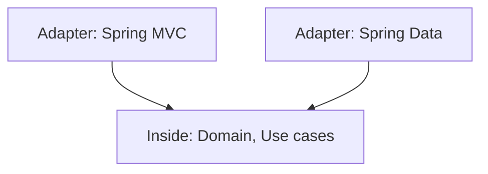

#Architecture #AppArchitecture #Backend #SpringBoot

Domain and use cases sit **inside**. Ports are interfaces defined by the inside. Onion and Clean Architecture are the same dependency rule: dependencies point **inward**.
- **Domain**: entities and rules. Pure Java, no Spring
- **Use cases**: orchestrate the domain through ports
- **Ports**: what the inside needs from the outside
- **Adapters**: [[Spring MVC]] calls a use case. [[Spring Data]] implements a port

**Pros**:
- business rules independent of Spring
- swap the database or the HTTP layer without touching the domain
- use cases are easy to test

**Cons**:
- mappings between the request, the domain, and the row
- overkill for apps that mostly store and return data

Arrows show the direction of dependencies, not the request flow. Pairs with [[Domain Model]]. See [[Backend Architecture Overview]].
