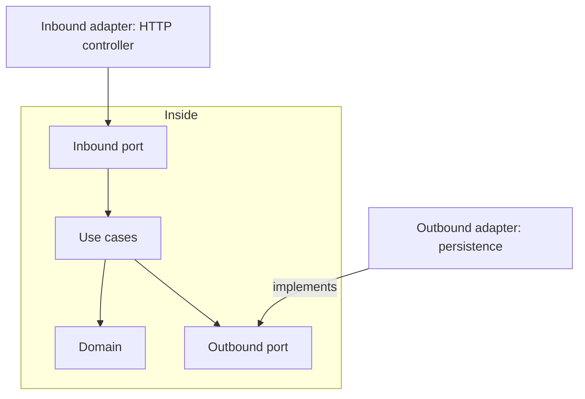

#Architecture #AppArchitecture #Backend

Also called **Ports and Adapters** (Alistair Cockburn). Domain and use cases sit **inside**, everything technical sits outside. Dependencies point **inward**: the inside defines interfaces (ports), the outside implements or calls them (adapters).
- **Domain**: entities, value objects, rules. Plain code, no framework, ORM or HTTP types
- **Use cases** (application services): orchestrate the domain, own the transaction
- **Inbound (driving) ports**: what the app offers, e.g. a `PlaceOrder` interface
- **Outbound (driven) ports**: what the app needs, e.g. an `Orders` repository interface or a `PaymentGateway`
- **Inbound adapters**: HTTP controllers, message consumers, scheduled jobs, CLI. They call inbound ports
- **Outbound adapters**: a persistence adapter on top of the ORM, an HTTP client for another system. They implement outbound ports

Onion Architecture and Clean Architecture share the same dependency rule and differ mostly in naming and how many rings they draw. The iOS version is [[Clean Architecture]].

The rule needs enforcement, folders alone don't hold it: architecture tests, separate build modules or projects for domain and adapters, or a language's visibility rules.

**Pros**:
- business rules independent of framework, database and transport
- swap the database or add another entry point (REST, messaging) without touching the domain
- domain and use cases testable with plain unit tests

**Cons**:
- mapping between request DTO, domain object and database entity
- more interfaces and packages
- overkill for apps that mostly store and return data

Arrows show the direction of dependencies, not the request flow.

## In Spring Boot
- inbound adapters: [[Spring MVC]] controllers, `@KafkaListener`, `@Scheduled`
- outbound adapters: a `@Component` implementing the domain's port with a Spring Data repository inside ([[Spring Data]])
- the domain has no Spring or JPA annotations. Spring wires ports to adapters ([[Spring Dependency Injection]])
- enforce the rule with ArchUnit tests, Spring Modulith, or separate Maven / Gradle modules

Pairs with [[Domain Model]]. See [[Backend Architecture Overview]].
