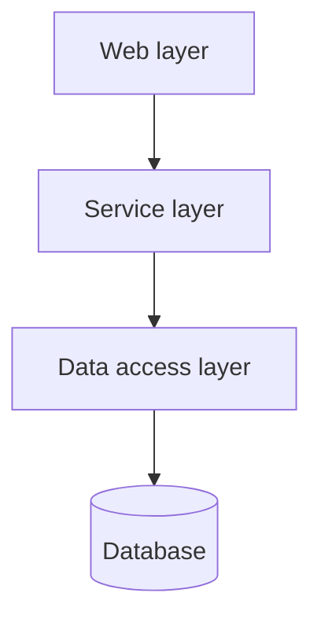

#Architecture #AppArchitecture #Backend

Three layers. Dependencies point **downward**: the web layer calls the service, the service calls the data access layer. The default shape of most backend frameworks and tutorials (Spring Boot, ASP.NET, NestJS, Django, Rails).
- **Web layer** (controllers, handlers): HTTP in, response out
- **Service layer**: the use case. Holds the rules and the transaction
- **Data access layer** (repositories, DAOs, ORM): loads and saves rows

Variants:
- **Strict**: each layer only calls the one directly below
- **Relaxed**: a layer may skip one (e.g. a controller reading through a repository for simple lookups)
- the database entity usually travels through all layers. Unlike [[Hexagonal Architecture]], the service depends on the database layer, not the other way round

Package-by-layer is the usual layout: `controllers`, `services`, `repositories`. Package-by-feature (`orders`, `billing`, each with its own three layers) scales better, see [[Modular Monolith]].

**Pros**:
- familiar, every backend developer knows it
- fast to start, little ceremony
- easy to find a class by its role

**Cons**:
- the service absorbs the rules, entities stay plain data holders (see [[Domain Model]])
- in CRUD apps the service is often a pass-through to the repository
- business logic depends on persistence details (ORM entities, query APIs)
- folders and packages rarely stop a service from calling another feature's repository (see [[Modular Monolith]])

## In Spring Boot
`@RestController` ([[Spring MVC]]) → `@Service` with `@Transactional` ([[Transactions]]) → Spring Data repository ([[Spring Data]]). The JPA entity is often returned straight from the repository up to the controller.

Pairs with [[Transaction Script]]. See [[Backend Architecture Overview]].
