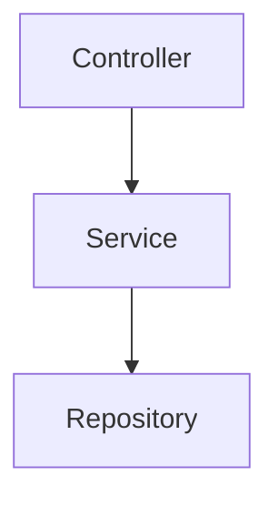

#Architecture #AppArchitecture #Backend #SpringBoot

Three layers. Dependencies point **downward**: the controller calls the service, the service calls the repository.
- **Controller**: [[Spring MVC]]. HTTP in, response out
- **Service**: the use case. Holds the rules
- **Repository**: [[Spring Data]]. Loads and saves rows

Package-by-layer is the usual layout: `controller`, `service`, `repository`.

**Pros**:
- familiar, and fast to start
- easy to find a class by its role

**Cons**:
- the service absorbs the rules
- layers turn into pass-throughs
- packages don't stop a service from calling another feature's repository (see [[Modular Monolith]])

For package-by-feature, see [[Modular Monolith]]. Pairs with [[Transaction Script]]. See [[Backend Architecture Overview]].
