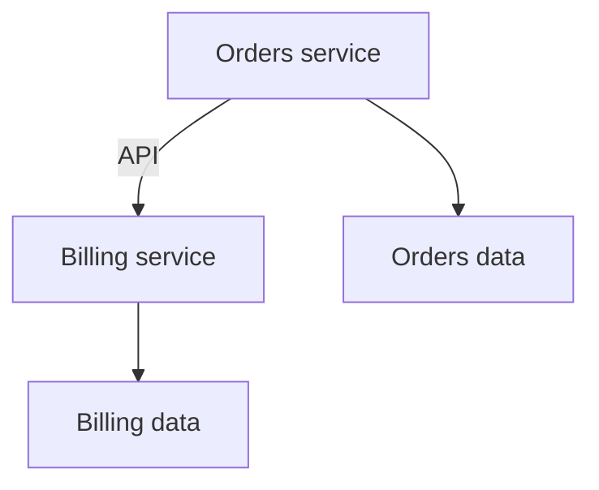

#Architecture #AppArchitecture #Backend #SpringBoot

Separate deployables. Each service owns its data.
- **Service**: its own process
- **Data**: its own database
- **API**: the only way another service reaches that data

**Pros**:
- independent deploy
- independent scale

**Cons**:
- network failures
- no shared transaction

Know it. Don't start here.

Start from a [[Modular Monolith]]. A [[Transactions]] boundary stops at the service. See [[Backend Architecture Overview]].
