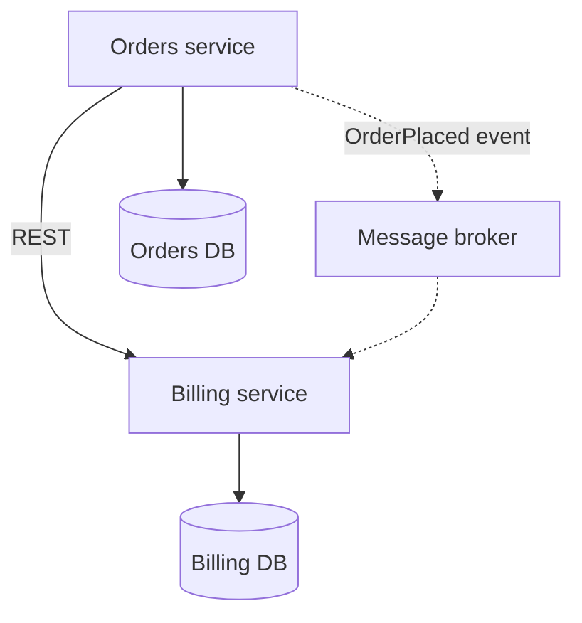

#Architecture #AppArchitecture #Backend

Separate deployables, each owning one business capability and its data.
- **Service**: its own process, its own release cycle, usually its own team
- **Data**: its own database or schema. No other service reads its tables
- **Communication**: synchronous (REST, gRPC) or asynchronous via a broker (Kafka, RabbitMQ). Async keeps services available when another one is down
- **Consistency**: no shared database transaction. Use the outbox pattern to publish events reliably and sagas for multi-step workflows. Data across services is eventually consistent
- **Infrastructure**: service discovery, API gateway, central config, circuit breakers, distributed tracing. Often provided by the platform (Kubernetes, a service mesh) rather than the framework

**Pros**:
- independent deploy and scale per service
- team autonomy, boundaries enforced by the network
- failures can be isolated
- services can use different languages and stacks

**Cons**:
- network failures, timeouts and retries everywhere
- no shared transaction, eventual consistency
- operational overhead: deployment, monitoring, tracing, API versioning
- code duplication: DTOs, API clients, validation and cross-cutting setup (auth, logging, error handling) repeated in every service. Shared libraries reduce it but couple the services again, since a library change forces coordinated releases
- wrong service boundaries are much harder to fix than wrong modules

Know it. Don't start here. Begin with a [[Modular Monolith]] and extract a service when a module has a real reason: different scaling, a separate team, a different release cadence. Plays the same role as [[RIBs]] on iOS, built for large organizations.

## In Spring Boot
- Spring Cloud: gateway, config server, service discovery, circuit breakers via Resilience4j
- Spring for Apache Kafka / Spring AMQP for messaging, Spring Modulith's event externalization for publishing events to a broker
- Micrometer for metrics and tracing (OpenTelemetry)
- `@Transactional` stops at the service boundary ([[Transactions]])
- on Kubernetes, the platform usually covers discovery and config, so less Spring Cloud is needed

See [[Backend Architecture Overview]].
