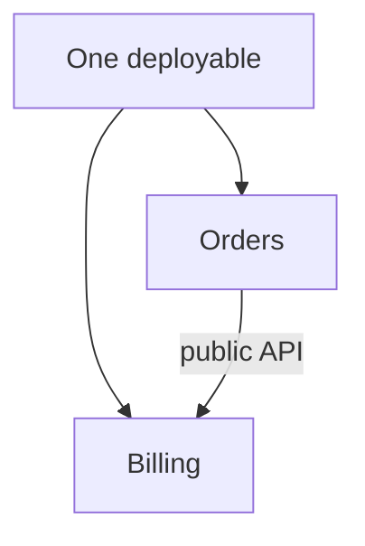

#Architecture #AppArchitecture #Backend #SpringBoot

One deployable, split into feature modules, usually with Spring Modulith. Package by feature (Orders, Billing), not by layer.
- **Module**: a public API and its own repositories
- **Public API**: an explicit call from one module to another
- **Spring application events**: a module publishes, another listens
- each module uses only its own repositories

**Pros**:
- one deployable to build and run
- boundaries stay visible in the code
- a use case can still commit in one transaction

**Cons**:
- a release still ships every module
- easy to call another module's repository
- events make the call path harder to see

A module that must deploy on its own is [[Microservices]]. See [[Backend Architecture Overview]].
