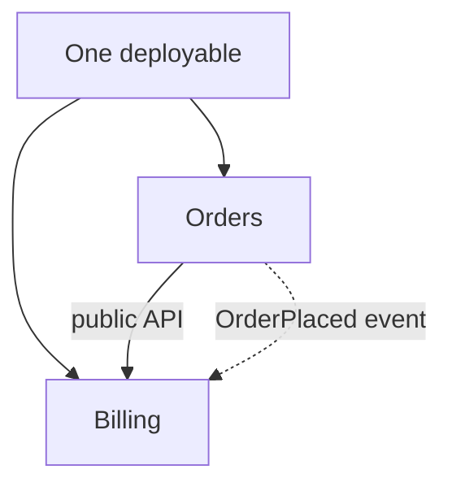

#Architecture #AppArchitecture #Backend

One deployable, split into business modules. Package by feature (`orders`, `billing`), not by layer. The backend counterpart of [[Modularization]] on iOS.
- **Module**: one business capability with its own code, data access and ideally its own tables or schema
- **Public API**: the only part other modules may call (a service interface, DTOs, events). Everything else is internal
- **In-process events**: a module publishes events, others subscribe. Decouples modules without a network
- inside, each module can be layered, hexagonal or sliced ([[Layered Architecture]], [[Hexagonal Architecture]], [[Vertical Slice]])

Boundaries need enforcement, folder names alone erode: separate build modules (Gradle / Maven modules, .NET projects, workspace packages), language visibility rules, or architecture tests.

**Pros**:
- one deployable to build, run and monitor
- boundaries visible and testable in the code
- a use case can still commit in one database transaction
- a module can later be extracted into a service if it really needs to

**Cons**:
- a release still ships every module, one module's bug can take down all
- shared database: easy to join across module tables and silently couple them
- events make the call path harder to follow
- cutting modules wrong is costly, same as with services

## In Spring Boot
[Spring Modulith](https://spring.io/projects/spring-modulith) treats each direct sub-package of the application class's package as a module, with sub-packages internal by default. A test (`ApplicationModules.of(App.class).verify()`) fails when a module uses another module's internals or when modules depend on each other in a cycle. It also offers:
- `@ApplicationModuleListener`: handles a Spring application event after the publishing transaction commits, in its own transaction
- an event publication registry, so events aren't lost if a listener fails
- generated module documentation

Alternatives: ArchUnit tests, or separate Gradle / Maven modules.

A module that must deploy or scale on its own becomes one of the [[Microservices]]. See [[Backend Architecture Overview]].
