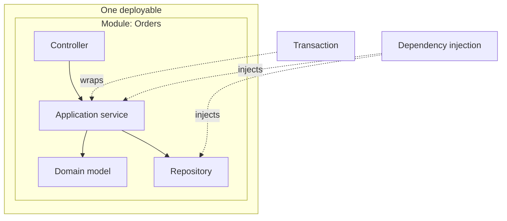

#Architecture #Backend

How the levels fit together. Each level answers a different question. The patterns are stack-neutral (Spring Boot, ASP.NET, NestJS, Django, Go). The Spring Boot notes show how each level looks in one concrete stack.

| Level                    | Question                                   | Patterns                                                                                      | In Spring Boot                  |
| ------------------------ | ------------------------------------------ | --------------------------------------------------------------------------------------------- | ------------------------------- |
| Application architecture | How is the backend split and structured?   | [[Layered Architecture]], [[Hexagonal Architecture]], [[Modular Monolith]], [[Microservices]] | Spring Modulith, Spring Cloud   |
| Use-case structure       | How is a single request handled?           | [[Transaction Script]], [[Domain Model]], [[CQRS]], [[Vertical Slice]]                        |                                 |
| API                      | How do clients reach a use case?           | controllers / handlers                                                                        | [[Spring MVC]]                  |
| Persistence              | How is data loaded and saved?              | repositories, ORM                                                                             | [[Spring Data]]                 |
| Consistency              | Where do transactions and invariants live? | one transaction per use case                                                                  | [[Transactions]]                |
| Wiring                   | How do objects get their dependencies?     | dependency injection                                                                          | [[Spring Dependency Injection]] |

They combine. The application architecture options answer two separate questions:
- **How is it deployed and split?** One deployable ([[Modular Monolith]]) or many ([[Microservices]])
- **How is each module structured inside?** [[Layered Architecture]] or [[Hexagonal Architecture]], optionally organized by [[Vertical Slice]]

A use-case pattern lives in the application core, behind a controller and in front of a repository, inside a module.

## Typical modern setup
- **Deployable**: one [[Modular Monolith]], package by feature, boundaries checked by tooling
- **App structure**: [[Hexagonal Architecture]] only where there's real business logic, [[Layered Architecture]] elsewhere
- **API**: thin controllers
- **Persistence**: repositories over an ORM or plain SQL
- **Consistency**: one transaction per use case, on the application service
- **Wiring**: constructor injection
- **More structure**: [[CQRS]] when read and write models diverge. [[Microservices]] only after those boundaries already exist

In Spring Boot: Spring Modulith for the module checks, [[Spring MVC]] controllers, [[Spring Data]] repositories, `@Transactional` on the service ([[Transactions]]), constructor injection ([[Spring Dependency Injection]]).

## Two families
- **The service holds the rules**: [[Layered Architecture]] plus [[Transaction Script]]. Entities are data. What most framework tutorials show
- **The domain holds the rules**: [[Hexagonal Architecture]] plus [[Domain Model]]. The service orchestrates; entities enforce invariants. Use this where the rules are real

## How to choose
- team size and experience
- how long the service will live
- how real the business rules are: mostly CRUD favors the first family, complex invariants the second
- the choice can differ per module: a CRUD module stays layered, the core module gets a domain model
- simple first, more structure only when it pays off
- apply one approach consistently within a module, don't mix several styles side by side
