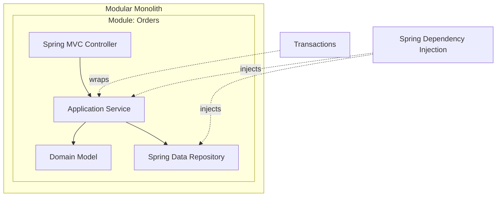

#Architecture #Backend

How the levels fit together. Each level answers a different question:

| Level | Question | Options |
|---|---|---|
| Application architecture | How is the backend layered and split? | [[Layered Architecture]], [[Hexagonal Architecture]], [[Modular Monolith]], [[Microservices]] |
| Use-case structure | How is a single request handled? | [[Transaction Script]], [[Domain Model]], [[CQRS]], [[Vertical Slice]] |
| API | How do clients reach a use case? | [[Spring MVC]] |
| Persistence | How is data loaded and saved? | [[Spring Data]] |
| Consistency | Where do transactions and invariants live? | [[Transactions]] |
| Wiring | How do objects get their dependencies? | [[Spring Dependency Injection]] |

They combine: a use-case pattern lives in the application core, behind a controller and in front of a repository.

## Typical modern setup (Spring Boot)
- **Deployable**: one [[Modular Monolith]], package by feature. [Spring Modulith](https://spring.io/projects/spring-modulith) when you want the boundaries checked
- **App structure**: [[Hexagonal Architecture]] only where there's real business logic
- **API**: thin [[Spring MVC]] controllers
- **Persistence**: [[Spring Data]] repositories
- **Consistency**: `@Transactional` on the application service ([[Transactions]])
- **Wiring**: constructor injection ([[Spring Dependency Injection]])
- **More structure**: [[CQRS]] when read and write models diverge. [[Microservices]] only after those boundaries already exist

## Two families
- **The service holds the rules**: [[Layered Architecture]] plus [[Transaction Script]]. Entities are data. This is what Spring Boot guides look like
- **The domain holds the rules**: [[Hexagonal Architecture]] plus [[Domain Model]]. The service orchestrates; entities enforce invariants. Use this where the rules are real

## How to choose
- team size and experience
- how long the service will live
- how real the business rules are
- simple first, more structure only when it pays off
- apply one approach consistently, don't mix several in the same codebase
