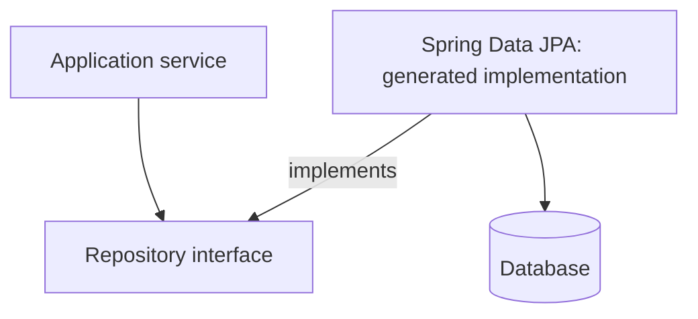

#Architecture #SpringBoot #Persistence

Repositories as interfaces. The application service loads and saves through them. Spring Data JPA is the usual case: you declare an interface, Spring generates the implementation at startup.

```java
interface OrderRepository extends JpaRepository<Order, Long> {
    List<Order> findByCustomerId(Long customerId);

    @Query("select o from Order o join fetch o.lines where o.id = :id")
    Optional<Order> findWithLines(Long id);
}
```

- **Derived queries**: the method name becomes the query (`findByCustomerId`)
- **`@Query`**: JPQL or native SQL when the name gets too long
- **Projections**: an interface or record as return type, loads only the fields a read needs (see [[CQRS]])
- alternatives: Spring Data JDBC (no lazy loading, no persistence context, aggregate-oriented), `JdbcClient`, jOOQ

Where the repository sits depends on the architecture:
- [[Layered Architecture]]: the service uses the Spring Data interface directly. The entity often doubles as the API model
- [[Hexagonal Architecture]]: the domain defines its own port (`Orders`). A persistence adapter implements it using a Spring Data repository and maps between JPA entity and domain object. The domain never sees `JpaRepository`

**Pros**:
- little code for the common queries
- the service depends on an interface, easy to replace in tests
- paging, sorting and auditing come for free

**Cons**:
- lazy associations touched outside a transaction throw `LazyInitializationException`. Spring Boot's default `spring.jpa.open-in-view=true` hides this by keeping the session open until the response is written, at the cost of queries running during rendering. Turn it off and load what you need in the service
- N+1 queries when a loop walks a lazy relation. Fix with `join fetch` or `@EntityGraph`
- long derived method names bury the real query
- the JPA entity needs a no-arg constructor and mutable fields, which fights a clean [[Domain Model]]



Arrows show the direction of dependencies. See [[Backend Architecture Overview]].
