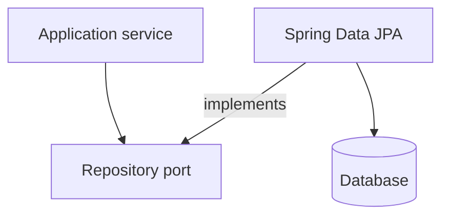

#Architecture #SpringBoot #Persistence

The repository is the outbound port. The application service loads and saves through it.

Spring Data JPA is the usual case. You declare an interface. Spring implements the queries.

```java
interface OrderRepository extends JpaRepository<Order, Long> {
    List<Order> findByCustomerId(Long customerId);
}
```

In [[Layered Architecture]] CRUD the entity often is the API model. In [[Hexagonal Architecture]] it stays behind a mapper.

**Pros**:
- little code for the common queries
- the service depends on an interface
- another store means another implementation

**Cons**:
- lazy associations touched after the session closes
- N+1 queries when a loop walks a relation
- derived method names that bury the real query



Arrows show the direction of dependencies. See [[Backend Architecture Overview]].
