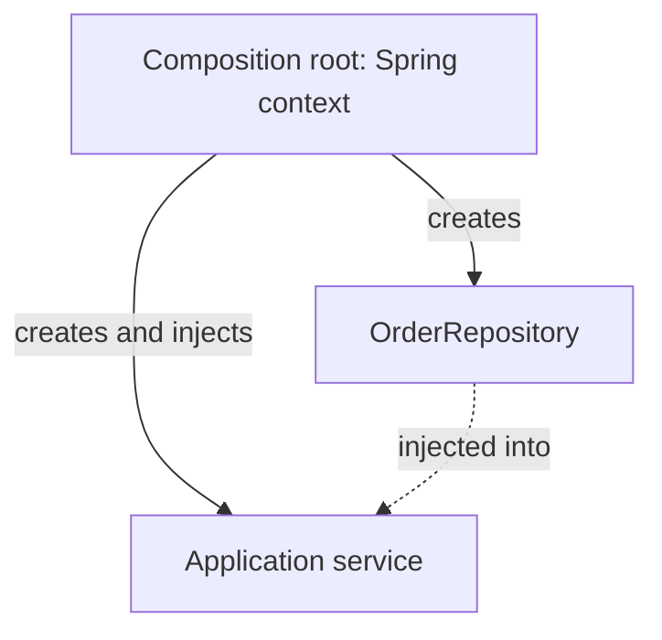

#Architecture #SpringBoot #DependencyInjection

Objects get their dependencies from outside instead of creating them. The Spring application context is the composition root: at startup it scans for beans, builds the object graph and injects it. Same idea as [[Dependency Injection]] on iOS, but the container is built in.

Common approaches:
- **Constructor injection**: collaborators as `final` fields, passed into the constructor. The default. With a single constructor no `@Autowired` is needed
- **Stereotypes**: `@Component`, `@Service`, `@Repository`, `@RestController`. Component scanning creates these beans. Used by [[Spring MVC]] and [[Spring Data]]
- **`@Bean`**: a method on a `@Configuration` class, for third-party types or objects you configure yourself (HTTP clients, `Clock`)
- **Several implementations of one interface**: pick with `@Primary` or `@Qualifier`, or switch with `@Profile` / `@ConditionalOnProperty`
- **Configuration values**: `@ConfigurationProperties` records instead of scattered `@Value`

```java
interface OrderRepository { Optional<Order> findById(Long id); }

@Service
class PlaceOrder {
    private final OrderRepository orders;

    PlaceOrder(OrderRepository orders) { this.orders = orders; }
}

// unit test: no Spring needed
PlaceOrder placeOrder = new PlaceOrder(mock(OrderRepository.class));
```

In tests, prefer a plain constructor call with mocks. Slice tests (`@WebMvcTest`, `@DataJpaTest`) start part of the context, `@SpringBootTest` starts all of it. Inside a context, `@MockitoBean` replaces a bean with a mock (Spring Boot 3.4 deprecated the older `@MockBean`).

**Pros**:
- mocks instead of a real database or HTTP client
- dependencies are visible on the constructor
- a missing or ambiguous bean fails at startup, not at first use

**Cons**:
- constructors with many parameters, usually a sign the class does too much
- field injection (`@Autowired` on fields) hides what the class needs and needs Spring to test
- circular dependencies. Spring Boot refuses them by default since 2.6
- a large context is slow to start and hard to trace



See [[Backend Architecture Overview]].
