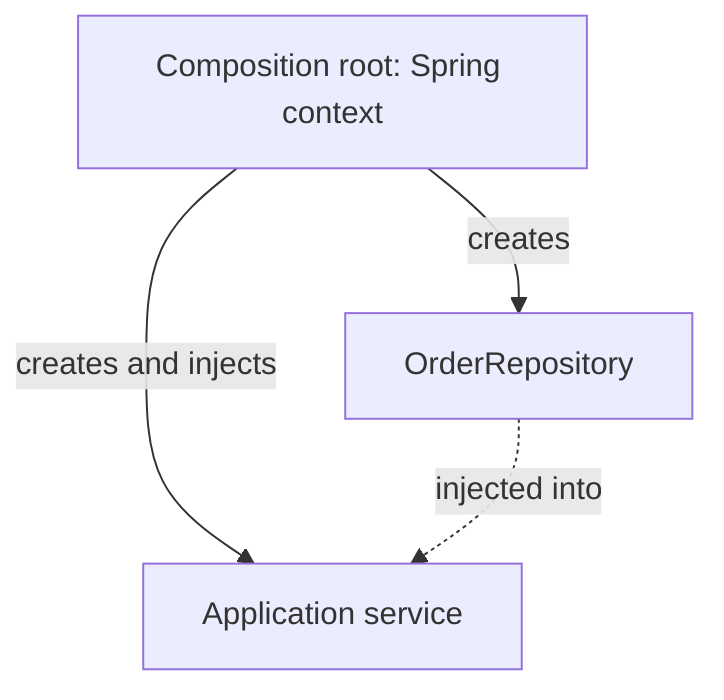

#Architecture #SpringBoot #DependencyInjection

Objects get their dependencies from outside instead of creating them. Tests pass mocks into the constructor. The Spring context is the composition root: it builds the graph at startup.

Common approaches:
- **Constructor injection**: pass collaborators into the constructor. The default
- **Stereotypes**: `@Service`, `@Repository`, `@RestController`. Spring creates these beans. Used by [[Spring MVC]] and [[Spring Data]]
- **`@Bean`**: a method on a `@Configuration` class, for a client or a third-party type you construct yourself

```java
interface OrderRepository { Order findById(Long id); }

@Service
class PlaceOrder {
    private final OrderRepository orders;

    PlaceOrder(OrderRepository orders) { this.orders = orders; }
}

// in tests
PlaceOrder placeOrder = new PlaceOrder(mock(OrderRepository.class));
```

**Pros**:
- mocks instead of a real database or HTTP client
- dependencies are visible on the constructor
- a missing bean fails at startup

**Cons**:
- constructors with many parameters
- field injection hides what the class needs
- a large context is slow to start and hard to trace



See [[Backend Architecture Overview]].
