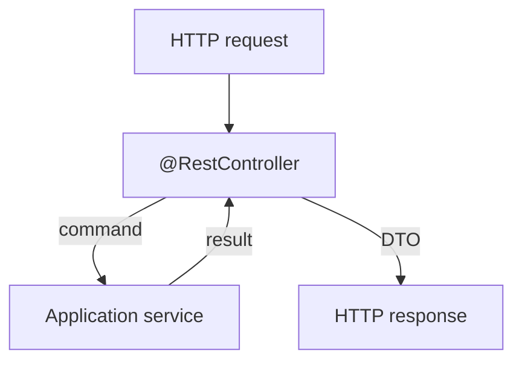

#Architecture #SpringBoot #API

`@RestController` is the inbound adapter. It turns HTTP into a command and calls the application service. A DTO comes in. A DTO goes out.

`@Valid` checks the body before the method runs. `@ControllerAdvice` maps exceptions to status codes in one place. Controllers stay thin.

Spring WebFlux is the reactive alternative: non-blocking handlers, still a thin adapter.

In [[Layered Architecture]] the controller is the top layer. In [[Hexagonal Architecture]] it is an adapter, and the use case sits behind it.

```java
@RestController
class OrderController {
    private final PlaceOrder placeOrder;

    OrderController(PlaceOrder placeOrder) { this.placeOrder = placeOrder; }

    @PostMapping("/orders")
    OrderResponse create(@Valid @RequestBody PlaceOrderRequest body) {
        return OrderResponse.from(placeOrder.execute(body.toCommand()));
    }
}
```

**Pros**:
- HTTP details stay at the edge
- validation and error mapping sit in one place
- the use case is callable from a test with no server

**Cons**:
- the controller grows when use case logic leaks in
- a JPA entity returned as the body couples the API to the schema (see [[Spring Data]])
- WebFlux is a different stack, not a drop-in replacement



See [[Backend Architecture Overview]].
