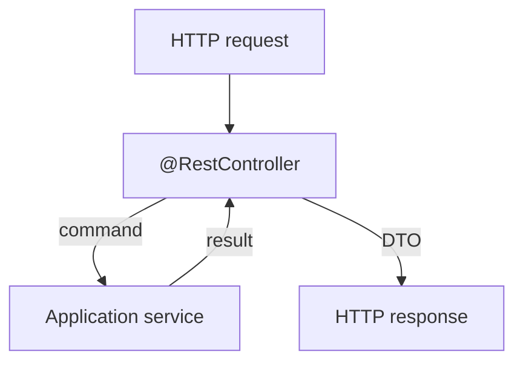

#Architecture #SpringBoot #API

`@RestController` is the inbound adapter. It turns HTTP into a command and calls the application service. A DTO comes in. A DTO goes out.

- **`@Valid`**: checks the request body against Bean Validation annotations (`@NotBlank`, `@Size`) before the method runs. Needs `spring-boot-starter-validation`. Validates the input format, not business rules
- **`@RestControllerAdvice`** with `@ExceptionHandler`: maps exceptions to status codes in one place. Spring 6 supports `ProblemDetail` (RFC 9457) as a standard error body
- **DTOs**: Java records, separate from entities, so the API can stay stable while the database changes

Controllers stay thin: parse, validate, call one use case, map the result.

Spring WebFlux is the reactive alternative: non-blocking handlers, `Mono` / `Flux` return types. With virtual threads (`spring.threads.virtual.enabled=true`, Java 21+) plain Spring MVC also handles many concurrent blocking requests, so WebFlux is rarely needed just for scale.

In [[Layered Architecture]] the controller is the top layer. In [[Hexagonal Architecture]] it is an adapter, and the use case sits behind it.

```java
@RestController
class OrderController {
    private final PlaceOrder placeOrder;

    OrderController(PlaceOrder placeOrder) { this.placeOrder = placeOrder; }

    @PostMapping("/orders")
    @ResponseStatus(HttpStatus.CREATED)
    OrderResponse create(@Valid @RequestBody PlaceOrderRequest body) {
        return OrderResponse.from(placeOrder.execute(body.toCommand()));
    }
}
```

**Pros**:
- HTTP details stay at the edge
- validation and error mapping sit in one place
- the use case is callable from a test without a server. `@WebMvcTest` tests only the HTTP layer

**Cons**:
- the controller grows when use case logic leaks in
- a JPA entity returned as the body couples the API to the schema and can trigger lazy loading during serialization (see [[Spring Data]])
- WebFlux is a different stack, not a drop-in replacement



See [[Backend Architecture Overview]].
