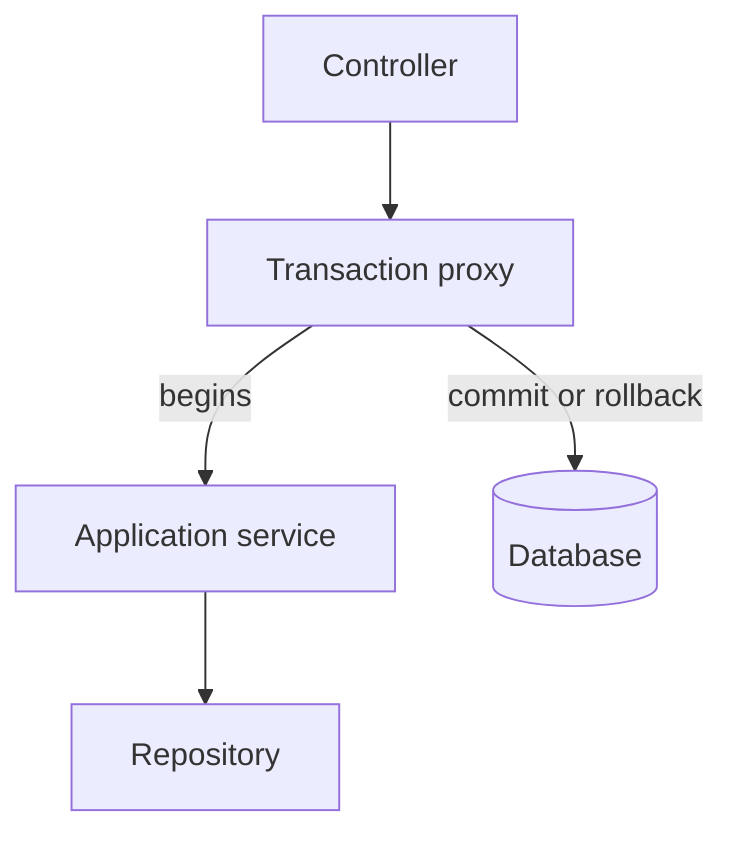

#Architecture #SpringBoot #Transactions

`@Transactional` goes on the application service. One transaction per use case. The method loads state, checks invariants, and saves. Spring commits when the method returns. A runtime exception rolls it back.

The same boundary fits a [[Transaction Script]] and a [[Domain Model]]. The rules run before commit.

```java
@Service
class PlaceOrderService {
    private final OrderRepository orders;

    PlaceOrderService(OrderRepository orders) { this.orders = orders; }

    @Transactional
    public void place(PlaceOrderCommand command) {
        Order order = orders.findById(command.orderId()).orElseThrow();
        order.confirm();
        orders.save(order);
    }
}
```

**Pros**:
- one use case commits together or rolls back together
- the controller stays outside the transaction
- a runtime exception undoes the writes

**Cons**:
- a call through `this` skips the proxy, so the inner `@Transactional` never runs
- a long method holds row locks
- each service commits its own database once you split into [[Microservices]]



See [[Backend Architecture Overview]].
