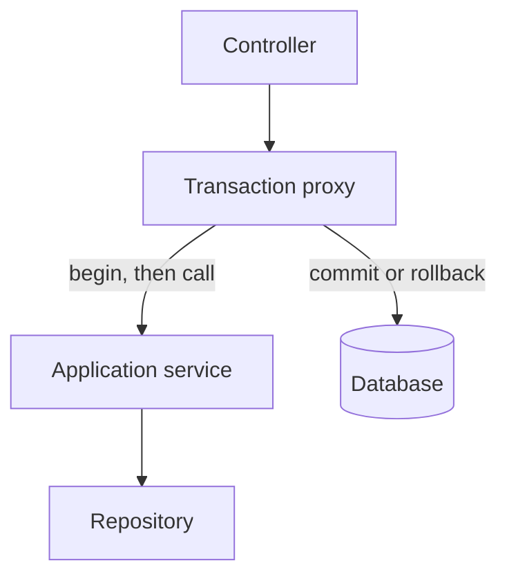

#Architecture #SpringBoot #Transactions

`@Transactional` goes on the application service. One transaction per use case. The method loads state, checks invariants, and saves. Spring wraps the bean in a proxy: it begins the transaction before the method and commits when the method returns.

The same boundary fits a [[Transaction Script]] and a [[Domain Model]]. The rules run before commit.

```java
@Service
class PlaceOrderService {
    private final OrderRepository orders;

    PlaceOrderService(OrderRepository orders) { this.orders = orders; }

    @Transactional
    public void place(PlaceOrderCommand command) {
        Order order = orders.findById(command.orderId()).orElseThrow();
        order.confirm();
        // no save() needed: JPA flushes changes to managed entities on commit (dirty checking)
    }

    @Transactional(readOnly = true)
    public OrderView find(Long id) { /* ... */ }
}
```

Rules worth knowing:
- **Rollback**: by default only on unchecked exceptions (`RuntimeException`, `Error`). A checked exception still **commits**, unless you set `rollbackFor`
- **Propagation**: the default `REQUIRED` joins an existing transaction. `REQUIRES_NEW` suspends it and starts its own (e.g. an audit log that must survive a rollback)
- **`readOnly = true`**: for queries. Hibernate skips dirty checking and flushing. With a routing data source it can also send reads to a replica
- **After commit**: `@TransactionalEventListener` runs code only once the transaction committed, e.g. sending an email

**Pros**:
- one use case commits together or rolls back together
- the controller stays outside the transaction
- declarative, no begin / commit code in the use case

**Cons**:
- the proxy only sees calls from outside: a call through `this` to another `@Transactional` method ignores that annotation (self-invocation)
- a checked exception commits unless configured otherwise
- a long method holds connections and row locks. Keep HTTP calls to other systems outside the transaction
- no transaction spans services once you split into [[Microservices]]. Use the outbox pattern or sagas instead



See [[Backend Architecture Overview]].
