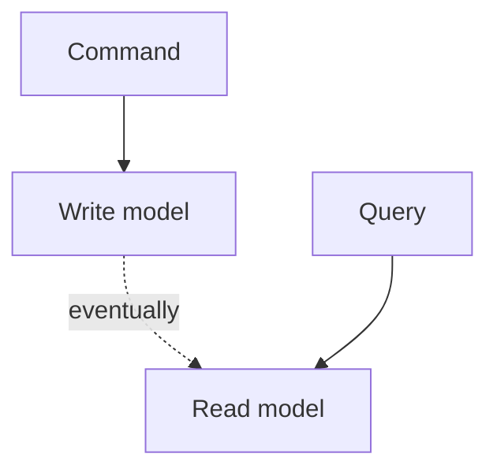

#Architecture #UseCase #Backend #SpringBoot

Separate the write model and the read model:
- **Command**: a change, handled by the write model
- **Query**: a read, handled by the read model
- **Write model**: normalized, enforces the invariants. Often a [[Domain Model]]
- **Read model**: shaped for the query, often a different table or store

Worth it when reads and writes diverge. Eventual consistency is the cost. After a command, a query can still return the old view.

**Pros**:
- reads and writes can be shaped and scaled apart
- the write model stays on the invariants

**Cons**:
- the read model lags the write
- two models to keep in sync
- extra machinery while one model still serves both

Event sourcing is the optional extreme. The write model is a log of events. The read model is a projection of that log. The usual form is two models and an ordinary database.

See [[Backend Architecture Overview]].
