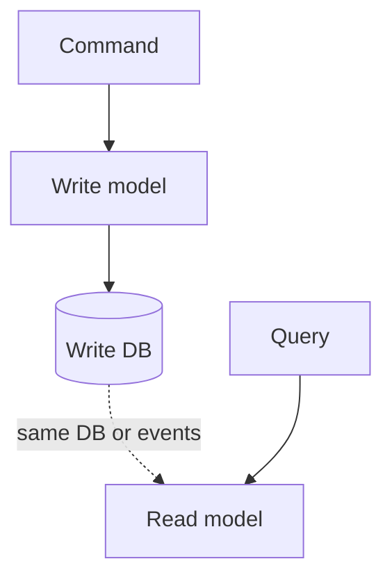

#Architecture #UseCase #Backend

**C**ommand **Q**uery **R**esponsibility **S**egregation (Greg Young). Separate the code that changes data from the code that reads it:
- **Command**: a change, handled by the write model. Returns nothing or just an id
- **Query**: a read, handled by the read model. Changes nothing
- **Write model**: shaped for the invariants, often a [[Domain Model]]
- **Read model**: shaped for the screen or API response, e.g. DTO queries, a SQL view, or a separate store (search index, denormalized table)

Levels, from light to heavy:
1. **Same database, separate code**: commands go through the domain, queries go straight to SQL into DTOs. Still fully consistent. Often all you need
2. **Separate read store**: updated from events after the write commits. Reads can lag behind: eventual consistency
3. **Event sourcing**: the write model is an append-only log of events, current state is rebuilt from it, read models are projections of that log. Full audit history, but event schemas are hard to change and the log is hard to query. Rarely worth it outside domains that need the history

Worth it when reads and writes diverge: complex invariants on write, many differently shaped reads, or very different load.

**Pros**:
- reads skip the domain model and fetch exactly what they need
- the write model stays focused on the invariants
- reads and writes can be optimized and scaled separately

**Cons**:
- two models to maintain
- with a separate read store: the read model lags the write, and sync can break
- extra machinery when one model still serves both

## In Spring Boot
- read side: Spring Data projections (interfaces or records), `JdbcClient` or jOOQ straight into DTOs. Avoids lazy loading and N+1 ([[Spring Data]])
- write side: a domain model and repositories, `@Transactional` ([[Transactions]])
- updating a separate read store: `@TransactionalEventListener` or Spring Modulith's `@ApplicationModuleListener`, or Kafka between services
- event sourcing: Axon Framework

See [[Backend Architecture Overview]].
