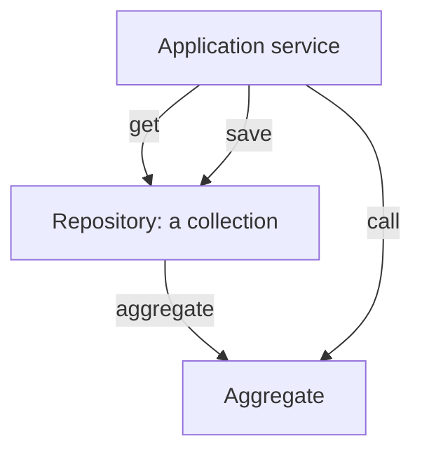

#Architecture #UseCase #Backend #SpringBoot

Entities, value objects, and aggregates hold the invariants. The service orchestrates:
- **Entity**: identity and behavior
- **Value object**: defined by its values, no identity
- **Aggregate**: the cluster you load and save together. The consistency boundary
- **Application service**: loads an aggregate, calls it, saves it
- **Repository**: looks like a collection. Get by id, add, remove

Pairs with [[Hexagonal Architecture]]. Anemic entities are the failure mode of the layered style. The objects are rows, and the rules stay in the service. See [[Layered Architecture]] and [[Transaction Script]].

**Pros**:
- an invariant lives in one place
- the service stays thin
- the domain can be tested without Spring

**Cons**:
- more types than CRUD needs
- easy to leave the rules in the service and end up anemic
- query methods pile onto the repository and it stops looking like a collection

```java
public void placeOrder(OrderId id, List<Line> lines) {
    Order order = orders.get(id);
    order.place(lines);
    orders.save(order);
}
```



See [[Backend Architecture Overview]].
