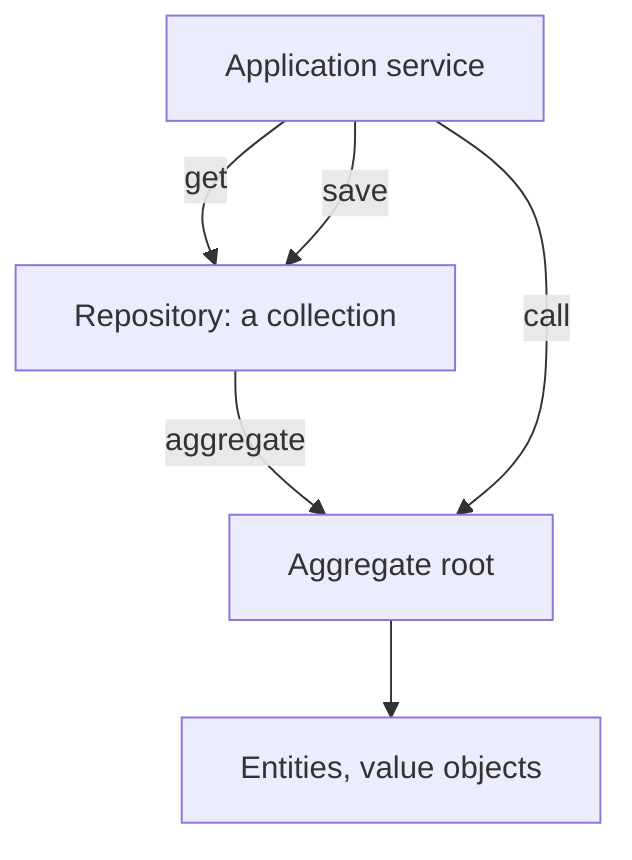

#Architecture #UseCase #Backend

Objects that hold both data and the rules (Martin Fowler, and the tactical part of Domain-Driven Design). The service only orchestrates:
- **Entity**: has an identity and behavior (`order.place()`), protects its own state. No public setters
- **Value object**: defined by its values, immutable, no identity (`Money`, `Address`)
- **Aggregate**: a cluster of objects loaded and saved together, with one root (`Order` with its `OrderLine`s). The consistency boundary: all invariants inside hold after every change
- **Application service**: loads an aggregate, calls it, saves it. Owns the transaction
- **Repository**: one per aggregate, looks like a collection. Get by id, add, remove
- **Domain event**: something that happened (`OrderPlaced`), for reactions outside the aggregate

Aggregate rules of thumb:
- reference other aggregates by id, not by object
- change one aggregate per transaction, update others via domain events
- keep aggregates small

Pairs with [[Hexagonal Architecture]]. The opposite is an **anemic domain model**: entities with only getters and setters while the rules live in services. That's the usual result of [[Layered Architecture]] with [[Transaction Script]].

With an ORM there are two options:
- **map the domain objects** directly: less code, but the ORM's needs (constructors, mutable fields, annotations, lazy collections) leak into the domain
- **separate persistence entities** mapped by an adapter: a clean domain, more mapping code

**Pros**:
- each invariant lives in one place and can't be bypassed
- the service stays thin
- the domain can be tested without a framework or database

**Cons**:
- more types and design work than CRUD needs
- easy to drift back into an anemic model
- ORMs and rich domain objects don't fit together without compromises
- list and search screens don't fit aggregates well, use separate queries (see [[CQRS]])



## In Spring Boot
Value objects as Java records, the application service as a `@Service` with `@Transactional` ([[Transactions]]). JPA needs a no-arg constructor and works best with mutable fields, which is why many teams keep separate JPA entities behind a mapper ([[Spring Data]]). Spring Data JDBC fits aggregates better: it loads and saves a whole aggregate, without lazy loading. Domain events can be published with `@DomainEvents` / `AbstractAggregateRoot` on save.

```java
class Order {
    private final List<OrderLine> lines = new ArrayList<>();
    private Status status = Status.DRAFT;

    void place() {
        if (lines.isEmpty()) throw new IllegalStateException("order has no lines");
        status = Status.PLACED;
    }
}

@Transactional
public void placeOrder(OrderId id) {
    Order order = orders.get(id);
    order.place();
    orders.save(order);
}
```

See [[Backend Architecture Overview]].
