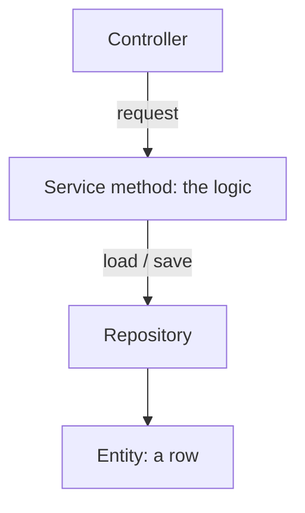

#Architecture #UseCase #Backend #SpringBoot

One service method per request. The logic lives in the service. Entities are rows:
- **Service method**: one per request. It validates, decides, and writes
- **Entity**: a row. Fields, no behavior
- **Repository**: loads and saves those rows

The default for CRUD. Pairs with [[Layered Architecture]].

**Pros**:
- simple and fast to start
- no extra domain types
- easy to follow: one method, one request

**Cons**:
- rules duplicate as the domain grows
- two methods can enforce the same rule differently
- the service absorbs every new case (see [[Domain Model]])

```java
public Order placeOrder(PlaceOrder command) {
    if (command.lines().isEmpty()) {
        throw new IllegalArgumentException("order has no lines");
    }
    return orders.save(new Order(command.customerId(), command.lines()));
}
```



See [[Backend Architecture Overview]].
