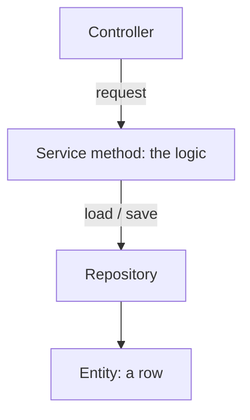

#Architecture #UseCase #Backend

One procedure per request (Martin Fowler, *Patterns of Enterprise Application Architecture*). The logic lives in the service, entities are data:
- **Service method**: one per request. Validates, decides, writes, all inside one database transaction
- **Entity**: a row. Fields, getters, setters, no behavior
- **Repository**: loads and saves those rows

The default for CRUD and simple workflows, in every stack. Pairs with [[Layered Architecture]].

**Pros**:
- simple and fast to start
- no extra domain types or mapping
- easy to follow: one method, one request

**Cons**:
- rules duplicate as the domain grows: two methods can enforce the same rule differently
- nothing stops code from putting an entity into an invalid state through its setters
- services grow into long classes with many dependencies
- when that happens, move rules into the entities (see [[Domain Model]])



## In Spring Boot
A `@Service` method with `@Transactional` ([[Transactions]]), a JPA entity with setters, a Spring Data repository ([[Spring Data]]).

```java
@Transactional
public Order placeOrder(PlaceOrder command) {
    if (command.lines().isEmpty()) {
        throw new IllegalArgumentException("order has no lines");
    }
    Order order = new Order();
    order.setCustomerId(command.customerId());
    order.setLines(command.lines());
    order.setStatus(Status.PLACED);
    return orders.save(order);
}
```

See [[Backend Architecture Overview]].
