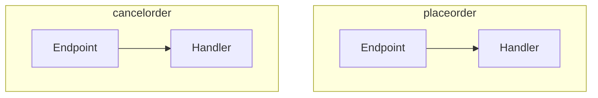

#Architecture #UseCase #Backend #SpringBoot

One package per use case, not per layer:
- **Slice**: one use case. Endpoint, request, handler, and response live in the same package
- **Handler**: the work for that one request

Distinct from a [[Modular Monolith]] module, which is still layered inside ([[Layered Architecture]]). A module is a business area, such as Orders or Billing. A slice is a single request.

More idiomatic in .NET than in Spring. In Spring, package-by-feature is the milder version: one package per feature, with several use cases inside.

**Pros**:
- a change to one request stays in one package
- a use case arrives and leaves as one package

**Cons**:
- shared rules have no single home, and get copied between slices
- less natural in Spring than package-by-feature
- easy to mistake a slice for a module boundary

See [[Backend Architecture Overview]].
