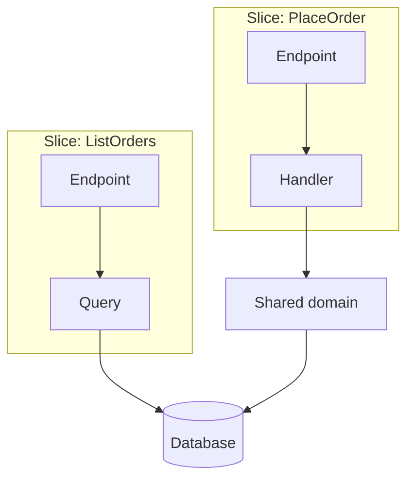

#Architecture #UseCase #Backend

**Vertical Slice Architecture** (Jimmy Bogard). One folder or package per use case, not per layer:
- **Slice**: one request, end to end. Endpoint, request, handler, response and its query live together
- **Handler**: the work for that one request. Each slice picks its own style: a simple query, a [[Transaction Script]], or a call into a [[Domain Model]]
- shared code only where several slices really need it (domain objects, infrastructure)

```text
orders/
  placeorder/   PlaceOrderEndpoint, PlaceOrderRequest, PlaceOrderHandler
  cancelorder/  CancelOrderEndpoint, CancelOrderHandler
  listorders/   ListOrdersEndpoint, ListOrdersQuery
```

Slices and modules are different levels: a [[Modular Monolith]] module is a business area (Orders, Billing), a slice is a single request. Slices can live inside a module, as an alternative to layering it.

Most popular in .NET (MediatR, minimal APIs). Fits any stack where endpoints can be declared per feature. Package-by-feature is the milder version: one package per feature with several use cases inside.

**Pros**:
- a change to one request stays in one place
- adding a use case doesn't touch the others
- no generic service classes that grow forever

**Cons**:
- shared rules have no obvious home and get copied between slices
- inconsistent styles across slices without team conventions
- easy to mistake a slice for a module boundary



## In Spring Boot
Less common than package-by-feature, because Spring encourages one controller and one service per feature. A slice is a package with a small `@RestController`, a request record and a handler `@Service` (or one class that does both). Package-private classes keep slices from depending on each other.

See [[Backend Architecture Overview]].
