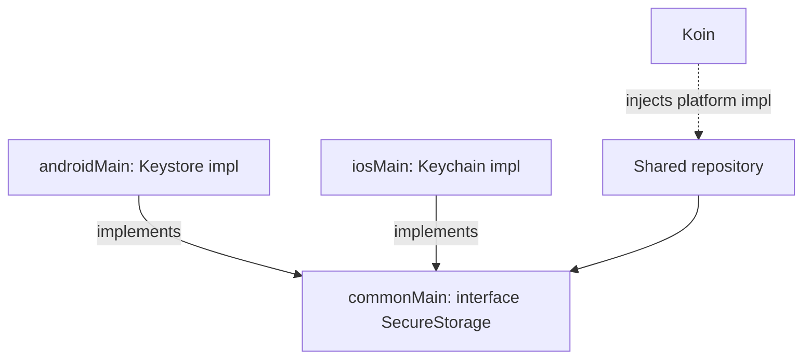

#Architecture #ComposeMultiplatform #Kotlin

How shared code reaches platform APIs. Two ways:
- **`expect` / `actual`**: `commonMain` declares an `expect` function or class, each platform source set provides the `actual` implementation. Checked by the compiler
- **Interfaces + DI**: `commonMain` defines an interface, platform code implements it, [[Koin]] injects it. The usual choice for anything with state or dependencies

```kotlin
// commonMain
expect fun platformName(): String

interface SecureStorage {
    fun save(key: String, value: String)
}

// iosMain
actual fun platformName(): String = UIDevice.currentDevice.systemName()

class KeychainStorage : SecureStorage { /* Keychain via Security framework */ }

// androidMain
actual fun platformName(): String = "Android ${Build.VERSION.SDK_INT}"
```

When to use which:
- `expect fun` for small, stateless helpers (a platform name, a UUID, a database driver factory)
- interfaces for services (storage, location, analytics, biometrics), so tests can use fakes
- `expect class` is still Beta, prefer interfaces
- check for an existing multiplatform library first (kotlinx-datetime, Okio, multiplatform-settings, DataStore)

**Pros**:
- full access to platform APIs from shared code
- compiler checks that every platform has an implementation
- interfaces make shared code testable

**Cons**:
- platform code written twice (Kotlin for Android, Kotlin calling iOS APIs for iOS)
- iOS APIs from Kotlin feel awkward (Objective-C types, `NSString`, pointers)
- easy to leak platform details into `commonMain`



Arrows show the direction of dependencies. See [[Compose Multiplatform Architecture Overview]].
