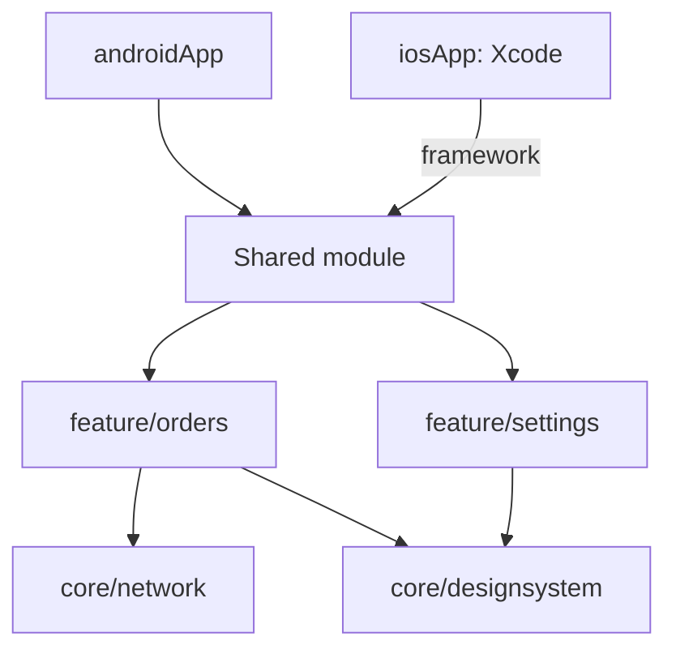

#Architecture #AppArchitecture #ComposeMultiplatform #Kotlin

A Kotlin Multiplatform project is one Gradle build with **source sets** per platform:
- **`commonMain`**: shared code, only Kotlin and multiplatform libraries. Most of the app
- **`androidMain`**, **`iosMain`**, `jvmMain` (desktop), `wasmJsMain` (web): platform code, can use Android SDK, iOS frameworks (UIKit, Foundation) or JVM libraries
- **`commonTest`**: shared tests, run on every platform
- source sets form a hierarchy: `iosMain` covers `iosArm64` and `iosSimulatorArm64`

Modules:
- **Shared module** (`composeApp` or `shared`): compiles to an Android library and an iOS framework
- **`androidApp`**: thin Android entry point (`Activity`). Newer templates keep it separate from the shared module
- **`iosApp`**: an Xcode project that embeds the shared framework and shows the shared UI ([[iOS Interop]])
- **Feature modules** (`feature/orders`) and **core modules** (`core/network`, `core/database`, `core/designsystem`), as in [[Modularization]] on iOS
- **Convention plugins** (`build-logic`): shared Gradle config, so each module's build file stays short

```text
composeApp/src/
  commonMain/   UI, ViewModels, repositories
  androidMain/  Android implementations
  iosMain/      iOS implementations, MainViewController
iosApp/         Xcode project
build-logic/    convention plugins
```

Shared resources (strings, images, fonts) live in `composeResources/` and are accessed type-safely via the generated `Res` class.

**Pros**:
- one codebase, compiler-checked boundaries between modules
- platform code isolated in its own source set
- same module structure as modern Android apps

**Cons**:
- Gradle and Kotlin/Native builds are slow, especially iOS linking
- iOS developers have to work with Gradle and Kotlin
- only one framework can be exported to iOS cleanly, so feature modules are exported through one umbrella module



See [[Compose Multiplatform Architecture Overview]].
