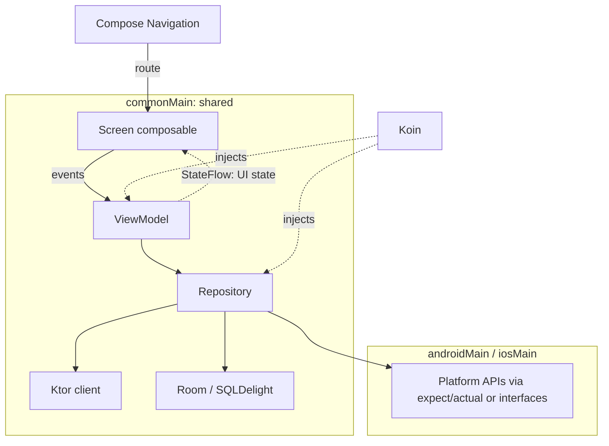

#Architecture #ComposeMultiplatform #Kotlin

**Kotlin Multiplatform (KMP)** shares Kotlin code across Android, iOS, desktop and web. **Compose Multiplatform** (by JetBrains, stable for iOS since 1.8) shares the UI too: Jetpack Compose running on every platform. Most Android architecture guidance (ViewModel, Navigation, Room) now works in shared code.

How the levels fit together. Each level answers a different question:

| Level | Question | Options |
|---|---|---|
| App architecture | How is the project split into modules and platforms? | [[KMP Project Structure]], [[Expect and Actual]] |
| UI architecture | How is a single screen structured? | [[Multiplatform ViewModel]] with UDF (MVVM / MVI), [[Compose State and Hoisting]] |
| Navigation | Who decides which screen comes next? | [[Compose Navigation]], alternatives Decompose, Voyager |
| Data | Where does data come from? | [[Multiplatform Data Layer]]: repositories, Ktor, Room / SQLDelight, Flow |
| Wiring | How do objects get their dependencies? | [[Koin]] |
| Platform | How does shared code meet iOS? | [[iOS Interop]] |

They combine: a screen is a composable that observes the state of a ViewModel. The ViewModel calls repositories in the data layer. All of it lives in `commonMain`, only platform APIs live in `androidMain` / `iosMain`.

Compared to the other mobile sections: the ViewModel is [[MVVM]] or [[MVI (Redux)]] as on iOS, the repository and use-case split is [[Clean Architecture]], feature modules are [[Modularization]]. Compared to React Native: Kotlin instead of JavaScript, compiled to native code on iOS, no JS bridge.

## Typical modern setup
- **Sharing**: UI and logic shared with Compose Multiplatform. Native screens only where the platform look matters (see [[iOS Interop]])
- **Modules**: a shared app module plus feature modules, Gradle convention plugins ([[KMP Project Structure]])
- **Screens**: stateless composables + a [[Multiplatform ViewModel]] exposing one `StateFlow` of UI state
- **Navigation**: [[Compose Navigation]] with type-safe `@Serializable` routes
- **Data**: repositories with Ktor, kotlinx.serialization, Room or SQLDelight, coroutines and Flow ([[Multiplatform Data Layer]])
- **Wiring**: [[Koin]], platform implementations injected as interfaces instead of `expect`/`actual` classes

## Share logic only, or UI too?
- **Shared logic, native UI** (KMP only): SwiftUI on iOS, Compose on Android, shared ViewModels or repositories. Most native look, two UIs to build
- **Shared UI** (Compose Multiplatform): one UI for all platforms. Fastest, but iOS doesn't look and feel fully native by default
- mixing is possible per screen

## How to choose
- team: Android / Kotlin experience makes Compose Multiplatform the natural choice, web / JS experience React Native
- how native the iOS app must feel
- simple first, more structure only when it pays off
- apply one approach consistently across features
