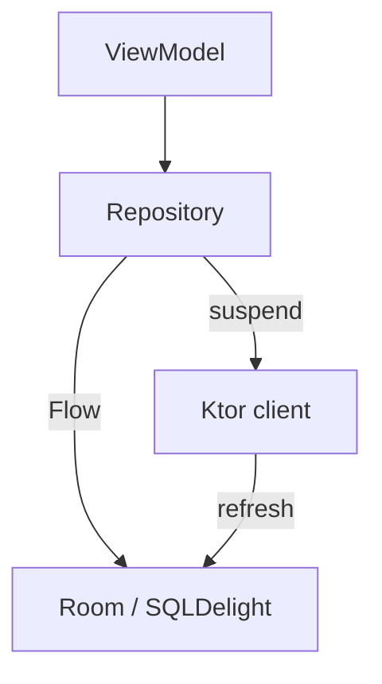

#Architecture #ComposeMultiplatform #Kotlin

The data layer lives in `commonMain`, built from multiplatform libraries. The usual Android setup: **repositories** in front of network and database, exposing coroutines and Flow.
- **Repository**: the single source of truth for one kind of data. Hides where data comes from. ViewModels only talk to repositories ([[Multiplatform ViewModel]])
- **Network**: Ktor client with kotlinx.serialization. Engines per platform: OkHttp on Android, Darwin (`NSURLSession`) on iOS
- **Database**: Room (multiplatform since 2.7, Android-style DAOs) or SQLDelight (SQL first, generates type-safe Kotlin)
- **Key-value storage**: DataStore or multiplatform-settings. Secrets via Keychain / Keystore ([[Expect and Actual]])
- **Coroutines and Flow**: `suspend` for one-shot calls, `Flow` for observed data
- **Use cases** (optional): one class per business action, only when logic is shared between ViewModels ([[Clean Architecture]])

```kotlin
class OrderRepository(
    private val api: OrderApi,      // Ktor
    private val dao: OrderDao,      // Room
) {
    fun observeOrders(): Flow<List<Order>> = dao.observeAll().map { it.toDomain() }

    suspend fun refresh() {
        dao.upsertAll(api.fetchOrders().map { it.toEntity() })
    }
}
```

**Offline first**: the UI observes the database, the network only refreshes it. The screen shows cached data immediately and updates when fresh data arrives. Compare [[TanStack Query]] in React Native, which caches in memory instead.

**Pros**:
- networking, persistence and business logic written once for every platform
- Flow from the database keeps every screen in sync automatically
- testable in `commonTest` with fakes or an in-memory database

**Cons**:
- mapping between DTO, database entity and domain model
- Kotlin/Native and Room / SQLDelight add build setup
- Flow and `suspend` functions are awkward to call from Swift ([[iOS Interop]])



See [[Compose Multiplatform Architecture Overview]].
