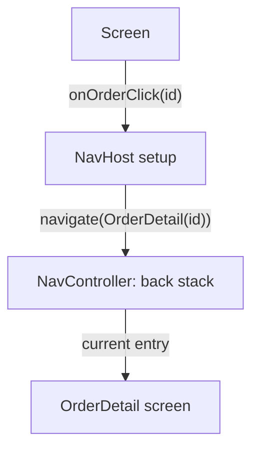

#ComposeMultiplatform #Kotlin #Navigation

The Jetpack Navigation library for Compose, ported to multiplatform by JetBrains. A `NavHost` shows the current destination, a `NavController` owns the back stack.
- **Type-safe routes**: `@Serializable` objects and data classes instead of string routes
- **Arguments**: route properties, read in the destination with `toRoute()` or in the ViewModel via `SavedStateHandle`
- **Nested graphs**: group a flow (onboarding, checkout) into its own graph
- **Deep links**: map URLs to routes
- each back stack entry has its own ViewModel scope ([[Multiplatform ViewModel]])

```kotlin
@Serializable data object OrderList
@Serializable data class OrderDetail(val id: String)

NavHost(navController, startDestination = OrderList) {
    composable<OrderList> {
        OrdersRoute(onOrderClick = { id -> navController.navigate(OrderDetail(id)) })
    }
    composable<OrderDetail> { entry ->
        OrderDetailRoute(id = entry.toRoute<OrderDetail>().id)
    }
}
```

Practices:
- screens get navigation lambdas (`onOrderClick`), not the `NavController`. Keeps them testable and reusable
- pass ids, not objects. The destination loads its own data
- each feature module exposes its routes and a `NavGraphBuilder` extension, the app module assembles them ([[KMP Project Structure]])
- the iOS swipe-back gesture and native transitions need extra work in shared UI ([[iOS Interop]])

Alternatives:
- **Navigation 3**: Google's newer library where the back stack is a plain list you own, close to [[SwiftUI Navigation]]
- **Decompose**: navigation and lifecycle in plain Kotlin, independent of the UI, works with SwiftUI too
- **Voyager**: simple screen-based navigation

**Pros**:
- official, the same API as Android
- type-safe routes and arguments
- ViewModel scoping per destination

**Cons**:
- iOS navigation feel (gestures, large titles) is not native out of the box
- passing results back between screens is clumsy
- the graph must know every destination



See [[Compose Multiplatform Architecture Overview]].
