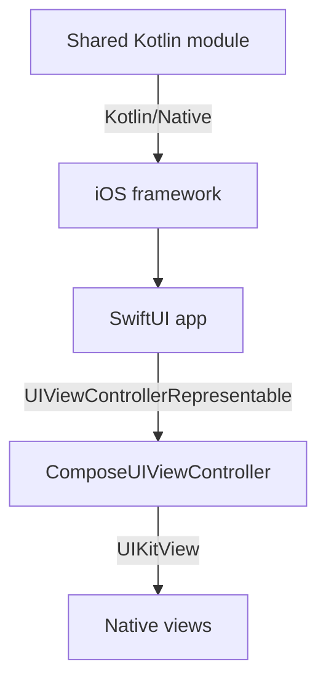

#ComposeMultiplatform #Kotlin #iOS #Platform

How shared Kotlin code and the iOS app meet. Kotlin/Native compiles the shared module into a native **framework** that the Xcode project embeds.
- **Shared UI on iOS**: `ComposeUIViewController { App() }` in `iosMain` returns a `UIViewController`. SwiftUI shows it via `UIViewControllerRepresentable`
- **Native views inside Compose**: `UIKitView` / `UIKitViewController` embed UIKit (maps, video, a SwiftUI view via `UIHostingController`)
- **Compose inside a native app**: a SwiftUI app can show single Compose screens, for gradual adoption
- **Calling Kotlin from Swift**: the framework exposes an Objective-C header. Classes, functions and data classes work; Kotlin-specific types are weakened

```kotlin
// iosMain
fun MainViewController() = ComposeUIViewController { App() }
```

```swift
struct ComposeView: UIViewControllerRepresentable {
    func makeUIViewController(context: Context) -> UIViewController {
        MainViewControllerKt.MainViewController()
    }
    func updateUIViewController(_ vc: UIViewController, context: Context) {}
}
```

Friction from Swift:
- `suspend` functions arrive as completion handlers or `async`, without cancellation
- `Flow` has no direct Swift equivalent
- sealed classes become class hierarchies without exhaustive `switch`, generics are limited
- fixes: **SKIE** (Touchlab) turns Flows into `AsyncSequence` and sealed classes into Swift enums, KMP-NativeCoroutines for Flow and suspend. **Swift export** (direct Swift API, no Objective-C) is in progress

iOS look and feel with shared UI: Compose Multiplatform supports iOS scrolling physics, text selection, accessibility (VoiceOver) and the swipe-back gesture, but Material components look like Android by default. Options: a custom design system, Cupertino-style components, or native SwiftUI screens for key parts.

**Pros**:
- shared UI and native UI can be mixed per screen
- full access to UIKit and SwiftUI where needed
- existing iOS apps can adopt Kotlin gradually

**Cons**:
- the Objective-C API surface loses Kotlin features without extra tools
- larger app size and slower iOS builds than pure Swift
- debugging Kotlin from Xcode needs a plugin
- iOS developers need Kotlin knowledge for shared code



See [[Compose Multiplatform Architecture Overview]] and [[iOS App Development]].
