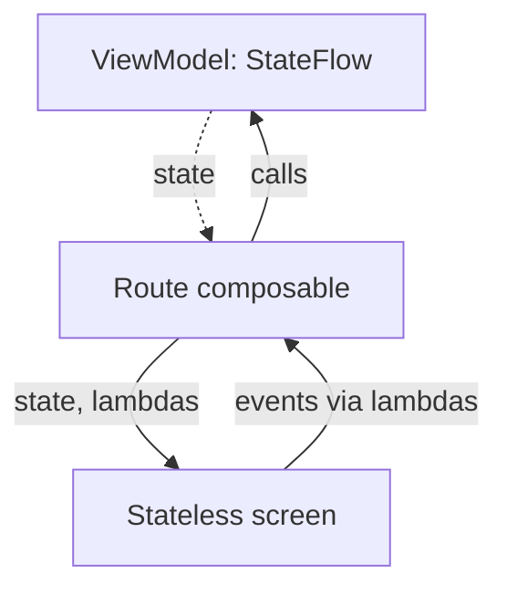

#ComposeMultiplatform #Kotlin #StateManagement

Compose is declarative like SwiftUI: a composable is a function of state and recomposes when that state changes. The core skill is deciding who **owns** a piece of state. Same as [[State Management]] on iOS.
- **`remember { mutableStateOf(...) }`**: local state, survives recomposition
- **`rememberSaveable`**: also survives configuration changes and process death on Android
- **State hoisting**: move state up to the caller. The composable gets `value` and `onValueChange` instead of owning state, so it becomes stateless
- **`collectAsStateWithLifecycle()`**: observes a ViewModel's `StateFlow`, stops collecting in the background ([[Multiplatform ViewModel]])
- **`CompositionLocal`**: values passed implicitly down the tree (theme, locale), like `@Environment` in SwiftUI

```kotlin
@Composable
fun OrdersRoute(viewModel: OrdersViewModel = koinViewModel()) {   // stateful
    val state by viewModel.state.collectAsStateWithLifecycle()
    OrdersScreen(state = state, onOrderClick = viewModel::onOrderClick)
}

@Composable
fun OrdersScreen(state: OrdersUiState, onOrderClick: (String) -> Unit) { // stateless
    /* ... */
}
```

Principle: **state down, events up**. Stateful "route" composables talk to the ViewModel; stateless screen and component composables only take state and lambdas. The same split as [[View Composition]] on iOS and [[Container and Presentational Components]] in React Native.

**Pros**:
- stateless composables are easy to preview, reuse and test
- one source of truth per piece of state
- recomposition updates the UI automatically

**Cons**:
- passing many lambdas down the tree
- unstable parameters (plain `List`, mutable classes) cause extra recompositions; use immutable data or the strong skipping mode
- easy to put logic into composables instead of the ViewModel



See [[Compose Multiplatform Architecture Overview]].
