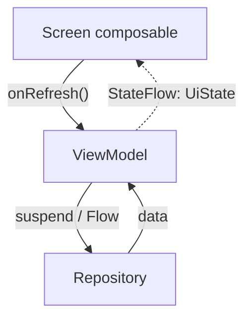

#Architecture #UIArchitecture #ComposeMultiplatform #Kotlin #UnidirectionalDataFlow

The AndroidX `ViewModel` works in `commonMain` (lifecycle 2.8+). One ViewModel per screen, holding the screen's state and logic. Recommended style: **unidirectional data flow** between [[MVVM]] and [[MVI (Redux)]]:
- **UI state**: one immutable `data class` exposed as `StateFlow`
- **Events**: the UI calls functions (`onOrderClick`) or sends a sealed `Intent` (stricter MVI)
- **One-off effects** (navigate, show a snackbar): modeled as state or a `Channel`. Avoid `SharedFlow` events that get lost
- **`viewModelScope`**: coroutines cancelled when the ViewModel is cleared
- survives configuration changes on Android, scoped to the navigation back stack entry on all platforms

```kotlin
data class OrdersUiState(
    val orders: List<Order> = emptyList(),
    val isLoading: Boolean = true,
    val error: String? = null,
)

class OrdersViewModel(private val repository: OrderRepository) : ViewModel() {
    val state: StateFlow<OrdersUiState> = repository.observeOrders()
        .map { OrdersUiState(orders = it, isLoading = false) }
        .catch { emit(OrdersUiState(isLoading = false, error = it.message)) }
        .stateIn(viewModelScope, SharingStarted.WhileSubscribed(5_000), OrdersUiState())

    fun onRefresh() = viewModelScope.launch { repository.refresh() }
}
```

Testing: plain unit tests in `commonTest` with fake repositories, `kotlinx-coroutines-test`, Turbine for Flows.

Alternatives: Decompose components (lifecycle-aware, not tied to Compose), Molecule (state as a composable function), Circuit (Slack's presenter / UI framework).

**Pros**:
- the same ViewModel on Android, iOS, desktop and web
- the UI is a pure function of one state object, easy to test and debug
- lifecycle and scoping handled by the framework

**Cons**:
- a single big state class can get complex
- one-off events are awkward in a state-based model
- ViewModels can grow into "Massive ViewModels", move logic into use cases or repositories
- using shared ViewModels from SwiftUI needs extra glue ([[iOS Interop]])



See [[Compose Multiplatform Architecture Overview]].
