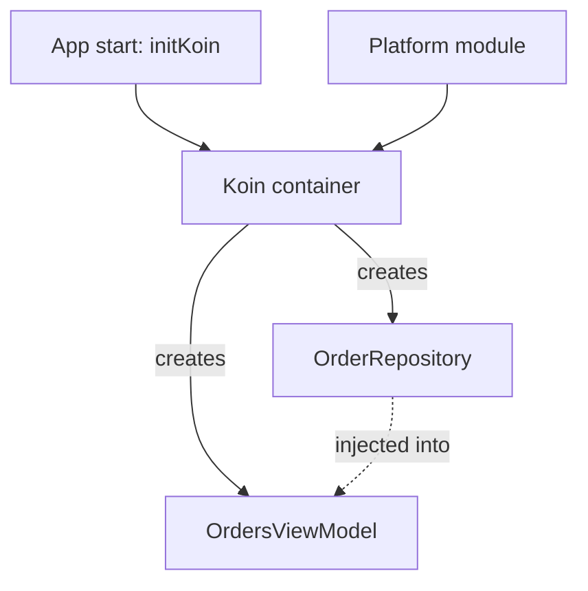

#Architecture #ComposeMultiplatform #Kotlin #DependencyInjection

The most common dependency injection library in Kotlin Multiplatform. A lightweight runtime container defined in a Kotlin DSL, no code generation needed. Same purpose as [[Dependency Injection]] on iOS.
- **Module**: declares how objects are created (`single`, `factory`, `viewModel`)
- **Platform module**: an `expect val platformModule` or a parameter of `initKoin`, so `androidMain` / `iosMain` provide platform implementations ([[Expect and Actual]])
- **Start**: `startKoin` in Android's `Application` and from Swift at app launch, or `KoinApplication` / `KoinMultiplatformApplication` as a composable
- **Injection in UI**: `koinViewModel()` in composables, scoped to the navigation entry ([[Compose Navigation]])

```kotlin
val dataModule = module {
    singleOf(::OrderRepository)
    single { HttpClient { install(ContentNegotiation) { json() } } }
}

val featureModule = module {
    viewModelOf(::OrdersViewModel)
}

fun initKoin(platform: Module) = startKoin {
    modules(platform, dataModule, featureModule)
}
```

Testing: ViewModels and repositories take constructor parameters, so tests create them with fakes directly. `checkModules` / `verify()` tests the Koin graph.

Alternatives with compile-time checks: kotlin-inject, Metro. Manual constructor injection works for small apps.

**Pros**:
- simple DSL, works in `commonMain`
- ViewModel and Compose integration
- fast to set up

**Cons**:
- a missing dependency fails at runtime, not at compile time
- service-locator style `get()` calls can hide dependencies
- large graphs are harder to follow than generated code



See [[Compose Multiplatform Architecture Overview]].
