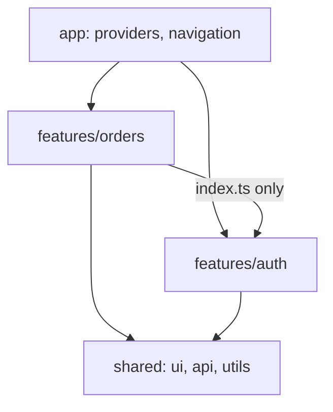

#Architecture #AppArchitecture #ReactNative

Group code by **feature**, not by type. Counterpart of [[Modularization]] on iOS and [[Modular Monolith]] on the backend. Same on React web.
- **Feature folder** (`features/orders`): everything for one feature: screens, components, hooks, API calls, query keys, Redux slice, types
- **Public API** (`features/orders/index.ts`): the only file other features import from
- **Shared** (`shared/`): UI kit, API client, utils, design tokens. Knows no feature
- **App** (`app/`): providers, navigation setup, store. Assembles the features

```text
src/
  app/          providers, navigation, store
  features/
    orders/     screens/, components/, hooks/, api.ts, keys.ts, slice.ts, index.ts
    auth/
  shared/       ui/, api/, utils/
```

Rules:
- features import from `shared/` and from other features' `index.ts` only, never from their internals
- `shared/` never imports from `features/`
- enforce with ESLint: `no-restricted-imports` or `eslint-plugin-boundaries`. Folders alone don't hold boundaries

**Monorepo** (pnpm, Yarn or Bun workspaces): only when several apps (mobile, web, admin) share packages, e.g. the API client, types or design system. Expo detects monorepos and configures Metro automatically.

**Pros**:
- a change to one feature stays in one folder
- features can be deleted or moved as a whole
- clear ownership for teams

**Cons**:
- deciding what's shared vs. feature-specific takes judgement
- without lint rules, features end up importing each other's internals
- cross-feature flows (checkout touches cart, orders, payment) need a home



See [[React Native Architecture Overview]].
