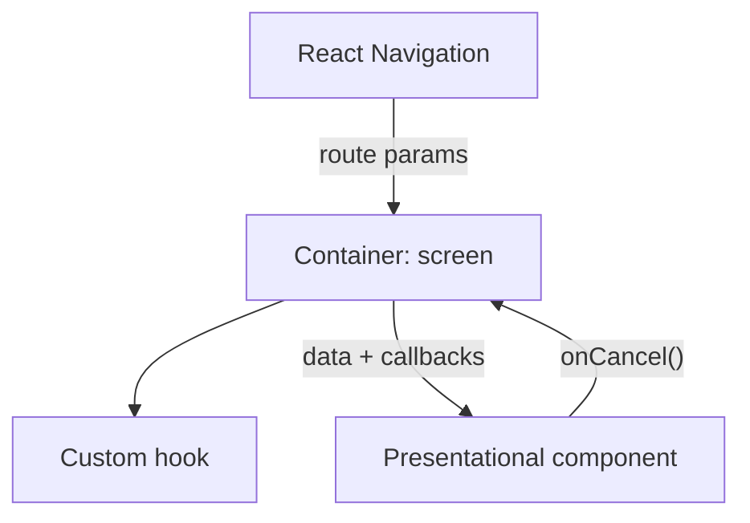

#Architecture #UIArchitecture #ReactNative

Split a screen into a component that knows where data comes from and components that only display it. The same idea as the container / presentational split in [[View Composition]] on iOS. Same on React web.
- **Container** (the screen): reads route params, calls a [[Custom Hooks|custom hook]], passes data and callbacks down. Little or no layout
- **Presentational component**: only props in, callbacks out. No queries, no Redux, no navigation. Styling and layout live here

Since hooks, the "container" is often just the screen component plus one custom hook, not a separate wrapper component.

```tsx
export function OrderScreen({ route }: Props) {            // container
  const { order, isPending, cancel } = useOrderScreen(route.params.id);
  if (isPending) return <LoadingView />;
  return <OrderDetail order={order} onCancel={cancel} />;
}

function OrderDetail({ order, onCancel }: OrderDetailProps) { // presentational
  return (/* ... */);
}
```

**Pros**:
- presentational components are easy to reuse, test and show in Storybook
- only the screen depends on data sources and navigation
- design changes don't touch data logic

**Cons**:
- props and callbacks have to be passed through (prop drilling)
- splitting too fine makes code hard to follow
- applied dogmatically, adds wrappers with no benefit



See [[React Native Architecture Overview]].
