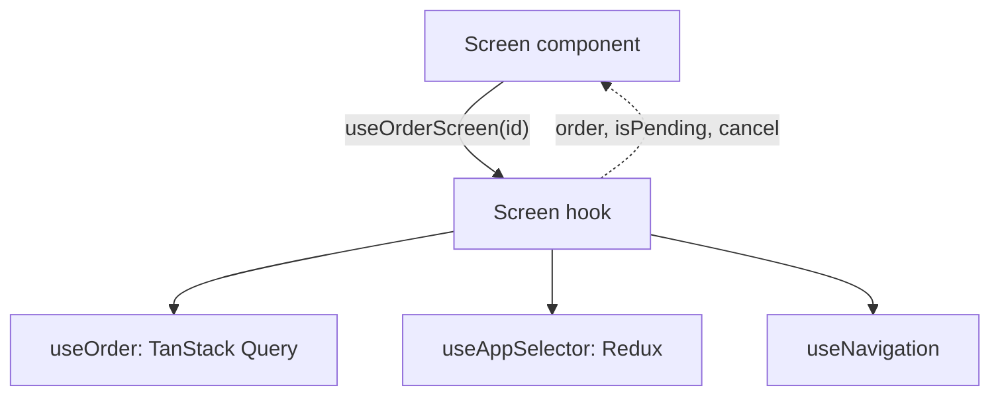

#Architecture #UIArchitecture #ReactNative

Functions starting with `use` that combine other hooks. The place for screen logic, so components only render. A screen hook plays the role of a ViewModel in [[MVVM]], without a class or binding framework. Same on React web.
- **Data hooks**: wrap one query or mutation (`useOrder`, `useCancelOrder`) ([[TanStack Query]])
- **Screen hooks**: combine data hooks, selectors and handlers for one screen (`useOrderScreen`)
- **Utility hooks**: reusable behavior (`useDebounce`, `useAppState`)

```ts
export function useOrderScreen(id: string) {
  const { data: order, isPending } = useOrder(id);
  const cancelOrder = useCancelOrder();
  const currency = useAppSelector((s) => s.settings.currency);
  const navigation = useNavigation();

  const cancel = () =>
    cancelOrder.mutate(id, { onSuccess: () => navigation.goBack() });

  return { order, isPending, currency, cancel };
}
```

Rules of hooks: call them only at the top level of a component or another hook, never in conditions or loops. The ESLint plugin `react-hooks` checks this.

Testing: `renderHook` from React Native Testing Library, wrapped in the needed providers ([[React Context and Providers]]).

Simple screens can call data hooks directly without a screen hook, close to [[MV]] on iOS.

**Pros**:
- logic testable without rendering UI
- components stay small and declarative
- logic reusable across screens and with React web

**Cons**:
- screen hooks can grow into "Massive ViewModels"
- dependency arrays of `useEffect`, `useMemo`, `useCallback` are easy to get wrong. React Compiler removes most manual memoization
- `useEffect` for derived state or data fetching is a common mistake. Compute values directly, fetch with TanStack Query



See [[React Native Architecture Overview]].
