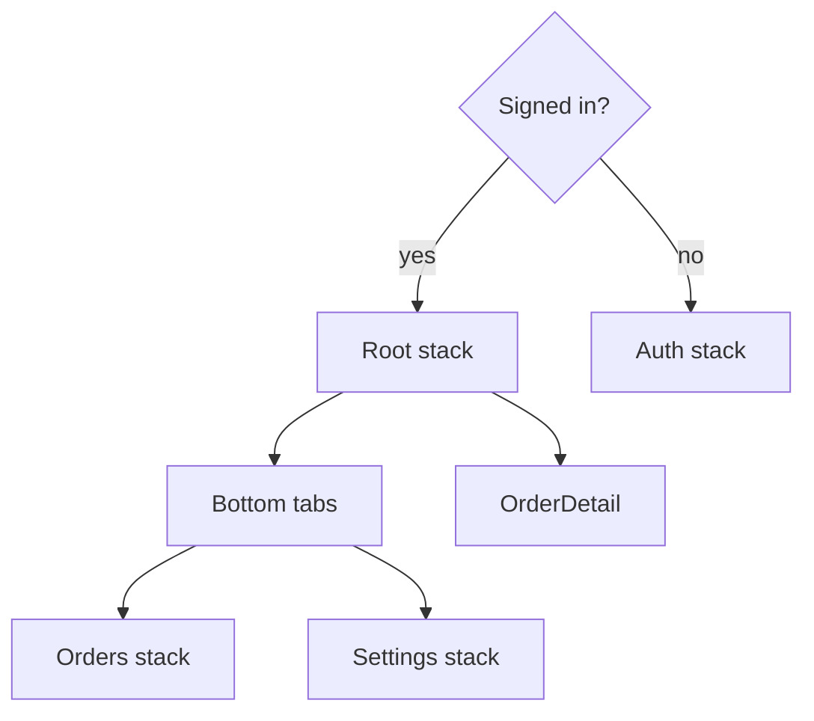

#ReactNative #Navigation

The standard navigation library for React Native. Navigation state lives in a `NavigationContainer`; screens navigate by name with params.
- **Native stack** (`createNativeStackNavigator`): push and pop with real native screens (`UINavigationController` on iOS)
- **Bottom tabs** (`createBottomTabNavigator`), **drawer** (`createDrawerNavigator`)
- **Nesting**: a stack per tab, tabs inside a root stack, modals in the root stack above the tabs
- **Static vs dynamic config** (v7): the static API declares screens as an object and infers types and deep links. The dynamic API uses JSX `<Stack.Screen>` and is more flexible

```ts
type RootStackParamList = {
  Tabs: undefined;
  OrderDetail: { id: string };
};

type Props = NativeStackScreenProps<RootStackParamList, 'OrderDetail'>;

navigation.navigate('OrderDetail', { id: order.id });
```

Practices:
- **Typed params**: a `ParamList` per navigator, declared globally so `useNavigation()` is typed everywhere
- **Pass ids, not objects**: the screen loads its data with [[TanStack Query]], so it always shows fresh data and deep links work
- **Auth flow**: render different screens depending on the auth state in [[Redux Toolkit]]. Signing in or out swaps the screen set, with no manual `navigate`
- **Deep linking**: a `linking` config maps URLs to screens and params
- **Focus**: screens in a stack stay mounted. Use `useFocusEffect` / `useIsFocused` for work on focus, e.g. refetching
- don't mirror navigation state in Redux

Expo Router is the file-based alternative built on React Navigation (routes from the `app/` folder, typed routes, deep links by default). Not used here.

**Pros**:
- native transitions and gestures with the native stack
- flexible nesting of stacks, tabs and modals
- typed navigation and deep linking

**Cons**:
- the dynamic API needs manual types and linking config
- nested navigators make `navigate` calls and deep links tricky
- screens are coupled to route names, unlike a router owned by a coordinator ([[MVP-C]], [[SwiftUI Navigation]])



See [[React Native Architecture Overview]].
