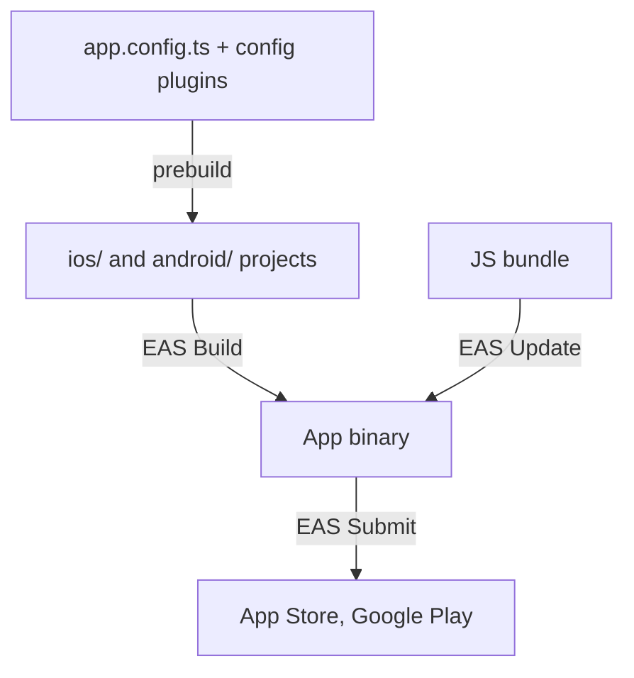

#ReactNative #Expo #Platform

Framework and tooling on top of React Native, the officially recommended way to start a React Native app. Adds a set of native modules (camera, notifications, secure store, ...), a build service and over-the-air updates.
- **Continuous Native Generation (CNG)**: `npx expo prebuild` generates the `ios/` and `android/` projects from `app.json` / `app.config.ts`. These folders usually aren't committed, so React Native upgrades don't mean hand-merging native projects
- **Config plugins**: change native config (Info.plist, AndroidManifest, entitlements) as code during prebuild. Libraries ship their own
- **Development build** (`expo-dev-client`): your own debug app with your native modules. Replaces Expo Go, which only contains Expo's built-in modules
- **EAS Build**: builds iOS and Android binaries in the cloud, including signing
- **EAS Submit**: uploads builds to the App Store and Google Play
- **EAS Update**: over-the-air updates of the JavaScript bundle and assets, without a store release. **Channels** map builds to update streams (production, preview). The **runtime version** makes sure an update only reaches binaries with matching native code

**Pros**:
- no manual Xcode and Gradle project maintenance
- easier React Native upgrades (one Expo SDK version per React Native version)
- JavaScript fixes ship in minutes via EAS Update
- a large set of maintained native modules

**Cons**:
- native changes (new native library, permissions) need a new binary and store release, OTA can't ship them
- libraries without a config plugin need one written, or a committed native folder
- EAS is a paid service beyond the free tier (local builds are possible)

Native code beyond what Expo provides: [[Native Modules]]. See [[React Native Architecture Overview]].
