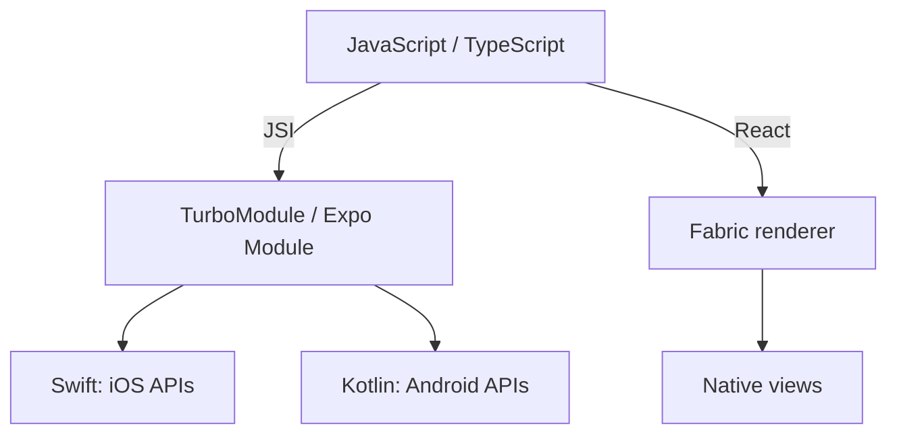

#ReactNative #Expo #Platform

How JavaScript talks to native code (Swift, Kotlin).

**New Architecture**, the default since React Native 0.76 and Expo SDK 52:
- **JSI** (JavaScript Interface): JavaScript calls C++ directly. Replaces the old asynchronous JSON bridge
- **TurboModules**: native modules on JSI. Loaded lazily, can be called synchronously
- **Fabric**: the new renderer. Synchronous layout, works with React's concurrent features
- **Codegen**: generates typed native interfaces from TypeScript specs

Writing your own module:
- **Expo Modules API**: Swift and Kotlin with a small declarative DSL, works with the New Architecture. The easiest way. `npx create-expo-module --local` adds a module to the app
- **Turbo Native Modules**: React Native's own API with a TypeScript spec and Codegen, more setup

```swift
public class BatteryModule: Module {
  public func definition() -> ModuleDefinition {
    Name("Battery")
    Function("level") { UIDevice.current.batteryLevel }
  }
}
```

When to write one:
- a platform API no library covers (a specific SDK, HealthKit details, widgets)
- performance-critical work (image processing, crypto)
- reuse of existing native code from an iOS or Android app ([[iOS App Development]])

Prefer an existing Expo or community library first, a native module is code to maintain on two platforms.

**Pros**:
- full access to every platform API
- native performance where JavaScript is too slow
- with the Expo Modules API, little boilerplate

**Cons**:
- Swift and Kotlin knowledge needed, two implementations
- changes need a new binary, no OTA update ([[Expo]])
- older libraries not migrated to the New Architecture run only through the interop layer or not at all



See [[React Native Architecture Overview]].
