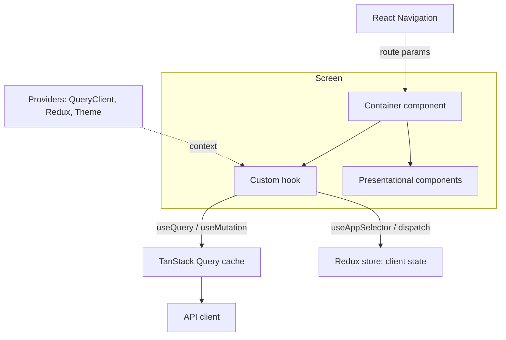

#Architecture #ReactNative #Expo

How the levels fit together. Each level answers a different question. Most patterns apply to React on the web too, only navigation and platform are React Native specific.

| Level | Question | Options |
|---|---|---|
| App architecture | How is the codebase organized? | [[Feature Folders]], monorepo for several apps |
| Component structure | How is a single screen built? | [[Container and Presentational Components]], [[Custom Hooks]] |
| Navigation | Who decides which screen comes next? | [[React Navigation]] |
| State | Who owns which data? | [[Server State vs Client State]]: [[TanStack Query]] for server data, [[Redux Toolkit]] for global client state, `useState` for local UI state |
| Wiring | How do components get services and config? | [[React Context and Providers]] |
| Platform and build | How does the app reach native code and the stores? | [[Expo]], [[Native Modules]] |

They combine: a screen is a thin container that calls a custom hook. The hook reads server data from TanStack Query and client state from Redux, and hands plain props to presentational components.

Compared to iOS: a custom hook plays the role of a ViewModel ([[MVVM]]), Redux is [[MVI (Redux)]], and simple screens that call hooks directly are close to [[MV]]. [[Clean Architecture]]'s dependency rule still applies: UI depends on hooks, hooks depend on the API client, never the other way round.

## Typical modern setup
- **Platform**: [[Expo]] with development builds and EAS, New Architecture on
- **Code organization**: one folder per feature ([[Feature Folders]])
- **Screens**: thin container + custom hook + presentational components
- **Server data**: everything from the API through [[TanStack Query]]
- **Client state**: [[Redux Toolkit]] only for real app state: auth session, preferences, cross-screen UI, offline drafts. `useState` for local UI state
- **Navigation**: [[React Navigation]] native stack and tabs, typed params
- **Wiring**: providers at the app root ([[React Context and Providers]])

**Main rule**: never copy server data into Redux. One owner per piece of data.

## How to choose
- what the data is: server data goes to the query cache, client state to Redux or local state
- the smallest scope that works: local state, then context, then Redux
- Expo by default; drop to bare React Native only for an unusual native build setup
- simple first, more structure only when it pays off
- apply one approach consistently, don't mix several state libraries for the same kind of data
