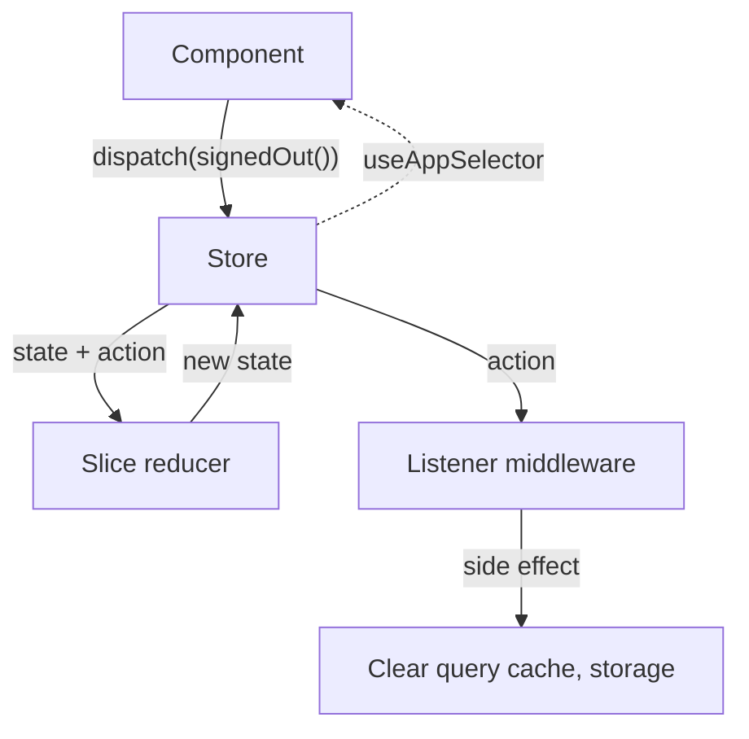

#ReactNative #StateManagement #Redux #UnidirectionalDataFlow

The official, modern way to write Redux. One global store for **client state**, updated only through dispatched actions. The general pattern is [[MVI (Redux)]], the Swift counterpart is [[TCA]]. Same API on React web.
- **Store** (`configureStore`): one per app, with DevTools and sensible middleware preconfigured
- **Slice** (`createSlice`): a piece of state, its reducers and generated action creators. Reducers can "mutate" thanks to Immer, the result is still immutable
- **Selector**: reads a value from the state. `createSelector` memoizes derived values
- **Typed hooks**: `useAppSelector` and `useAppDispatch`, typed once for the app
- **Listener middleware** (`createListenerMiddleware`): side effects in response to actions, e.g. clear the query cache on logout
- **Thunks** (`createAsyncThunk`): async logic. Rarely needed when server data lives in [[TanStack Query]]

```ts
const authSlice = createSlice({
  name: 'auth',
  initialState: { token: null as string | null },
  reducers: {
    signedIn: (state, action: PayloadAction<string>) => { state.token = action.payload; },
    signedOut: (state) => { state.token = null; },
  },
});

export const store = configureStore({ reducer: { auth: authSlice.reducer } });
export type RootState = ReturnType<typeof store.getState>;
export const useAppSelector = useSelector.withTypes<RootState>();
export const useAppDispatch = useDispatch.withTypes<typeof store.dispatch>();
```

What belongs in it:
- auth session and current user id
- user settings and feature flags
- cross-screen UI state (an onboarding step, a filter used on several screens)
- offline drafts and queued actions

What doesn't: API responses ([[Server State vs Client State]]), local UI state, navigation state, values derived from other state.

**Persistence**: redux-persist with an MMKV or AsyncStorage adapter, persisting only chosen slices (`whitelist`). Store tokens in `expo-secure-store` (Keychain / Keystore), not in plain storage.

**RTK Query**: Redux Toolkit's own data-fetching layer, the Redux-native alternative to TanStack Query. Not used here, so server data has only one owner.

**Pros**:
- predictable: state changes only through actions and reducers
- Redux DevTools: every action logged, time travel
- reducers and selectors are pure functions, easy to test
- much less boilerplate than classic Redux

**Cons**:
- still more ceremony than `useState` or a small store (Zustand)
- easy to misuse as a cache for server data
- badly written selectors (returning new objects) cause re-renders on every state change



See [[React Native Architecture Overview]].
