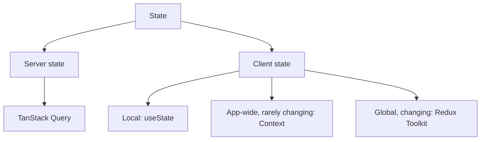

#ReactNative #StateManagement

The core distinction for state in React and React Native apps. Two kinds of state with different owners and different problems:
- **Server state**: owned by the backend. The app only holds a cached copy that can be stale, is shared across screens, and needs loading, error, refetching and invalidation. Owner: [[TanStack Query]]
- **Client state**: owned by the app. Always up to date, no loading. Examples: auth session, preferences, form drafts, which tab is open

Client state by scope:
- **Local UI state** (`useState`, `useReducer`): an input value, a toggle, a modal. Most state is this
- **Rarely changing app-wide values** (Context): theme, locale, injected services ([[React Context and Providers]])
- **Global client state** ([[Redux Toolkit]]): auth session, user settings, cross-screen UI, offline drafts
- **Navigation state** ([[React Navigation]]): which screen is shown and its params. Don't mirror it in Redux

Principle: **one owner per piece of data**. The same rule as in [[State Management]] on iOS.

**Anti-pattern**: API data copied into Redux with hand-written `isLoading` / `error` flags, thunks for every endpoint and manual refetching. That rebuilds a worse cache. Leave server data in the query cache and read it where needed.

Decision list:
1. Comes from the API? Query cache
2. Used by one component? `useState`
3. Rarely changes, needed in many places? Context
4. Changes often, needed across screens, or must survive restarts? Redux
5. Derived from other state? Compute it (a selector or `useMemo`), don't store it

**Pros**:
- each kind of state gets the tool built for it
- far less boilerplate than "everything in Redux"
- caching, retries and refetching come for free

**Cons**:
- two libraries to learn
- the border isn't always obvious (e.g. optimistic edits, offline drafts of server data)

See [[React Native Architecture Overview]].
