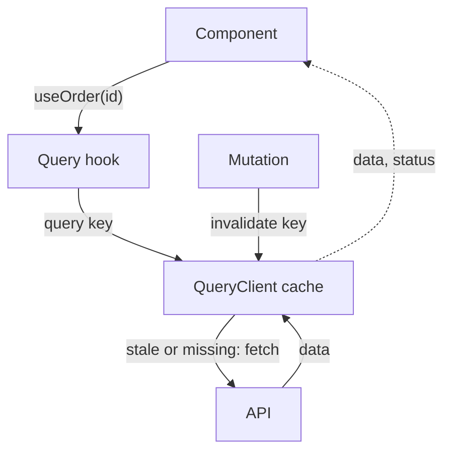

#ReactNative #StateManagement #TanStackQuery

Library for **server state** (formerly React Query). A cache in front of the API: components ask for data by key, the library fetches, caches, deduplicates, refetches and shares it. Same API on React web. See [[Server State vs Client State]].
- **Query** (`useQuery`): reads data. Identified by a **query key** (`['orders', 'detail', id]`)
- **Mutation** (`useMutation`): changes data on the server, then invalidates or updates affected queries
- **QueryClient**: holds the cache, provided at the app root ([[React Context and Providers]])
- **`staleTime`**: how long data counts as fresh. Default `0`: always refetched on mount, focus or reconnect. Raise it to cut requests
- **`gcTime`**: how long unused data stays in the cache (default 5 minutes, called `cacheTime` before v5)

```ts
export const orderKeys = {
  all: ['orders'] as const,
  list: (filter: string) => [...orderKeys.all, 'list', filter] as const,
  detail: (id: string) => [...orderKeys.all, 'detail', id] as const,
};

export function useOrder(id: string) {
  return useQuery({ queryKey: orderKeys.detail(id), queryFn: () => api.getOrder(id) });
}

export function useCancelOrder() {
  const queryClient = useQueryClient();
  return useMutation({
    mutationFn: api.cancelOrder,
    onSuccess: () => queryClient.invalidateQueries({ queryKey: orderKeys.all }),
  });
}
```

Patterns:
- **Query key factory** per feature (as above): keys stay consistent, invalidating `orderKeys.all` hits every order query
- **Custom hooks** per query (`useOrder`), never raw `useQuery` in screens ([[Custom Hooks]])
- **`select`**: derive or pick a slice of the data, the component only re-renders when that changes
- **Dependent queries**: `enabled: !!userId` waits for another value
- **Optimistic updates**: update the cache in `onMutate`, roll back in `onError`, invalidate in `onSettled`
- **Infinite lists**: `useInfiniteQuery` with `FlatList`'s `onEndReached`

React Native specifics (no browser events):
- **App focus**: wire `focusManager` to `AppState` so queries refetch when the app comes to the foreground
- **Online status**: wire `onlineManager` to NetInfo (`@react-native-community/netinfo`) so queries pause offline and refetch on reconnect
- **Screen focus**: screens stay mounted in a stack, so data doesn't refetch on going back. Use `useFocusEffect` from [[React Navigation]] to refetch stale queries
- **Offline persistence**: `PersistQueryClientProvider` with a storage persister (AsyncStorage or MMKV) restores the cache on app start. Paused mutations can resume after reconnect

**Pros**:
- caching, deduplication, retries and background refetching without own code
- loading and error states per query
- removes most of the Redux code in typical apps
- Devtools for inspecting the cache

**Cons**:
- query keys need discipline, a wrong key means stale or duplicated data
- invalidation logic gets scattered across mutations without key factories
- defaults (`staleTime: 0`, retries) surprise newcomers
- not a place for client state



See [[React Native Architecture Overview]].
