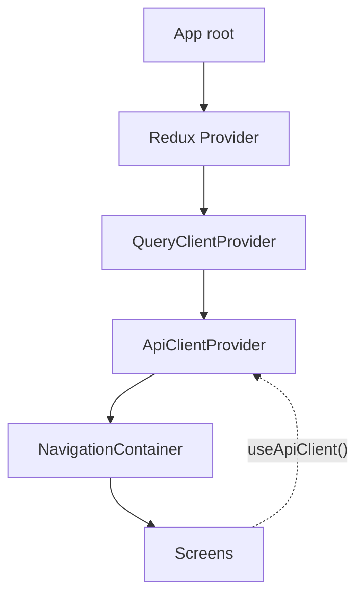

#Architecture #ReactNative #DependencyInjection

React's built-in way to pass values down the component tree without props. A **provider** puts a value into context, any descendant reads it with `useContext`. The React counterpart of `@Environment` and [[Dependency Injection]] on iOS. Same on React web.

The provider tree at the app root:

```tsx
export function App() {
  return (
    <ReduxProvider store={store}>
      <QueryClientProvider client={queryClient}>
        <ApiClientProvider client={apiClient}>
          <ThemeProvider>
            <NavigationContainer>
              <RootNavigator />
            </NavigationContainer>
          </ThemeProvider>
        </ApiClientProvider>
      </QueryClientProvider>
    </ReduxProvider>
  );
}
```

Uses:
- **Library wiring**: Redux store, QueryClient, navigation, safe area, gestures
- **Dependency injection**: the API client, analytics, feature flags. Tests and Storybook wrap components in providers with fakes
- **Rarely changing app values**: theme, locale

Not for frequently changing state: every consumer re-renders whenever the context value changes. Use [[Redux Toolkit]] (subscribes to slices via selectors) or local state instead ([[Server State vs Client State]]).

Practices:
- one context per concern, not one big app context
- a custom hook per context (`useApiClient()`) that throws if the provider is missing
- memoize object values (`useMemo`) so consumers don't re-render on every parent render

**Pros**:
- built in, no library
- swap implementations in tests and previews
- no prop drilling

**Cons**:
- re-renders all consumers on change
- deep provider nesting at the root
- a missing provider fails at runtime, not at compile time



See [[React Native Architecture Overview]].
