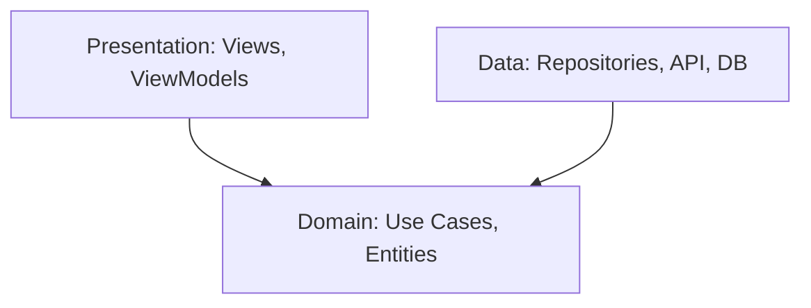

#Architecture #AppArchitecture

Splits the whole app into layers (not a screen pattern). Dependencies only point **inward**: the domain knows nothing about UI or database.
- **Presentation**: views and a UI architecture pattern ([[MVVM]], [[TCA]], ...)
- **Domain**: use cases and entities, the business logic. Pure Swift, no frameworks
- **Data**: repositories, API clients, database. Implements protocols defined by the domain (dependency inversion)

**Pros**:
- business logic independent of frameworks
- easy to test
- swap database or API without touching the domain

**Cons**:
- many layers and mappings between them (DTO -> Entity -> UI model)
- overkill for apps that mostly display API data

Arrows show the direction of dependencies, not the data flow. See [[iOS Architecture Overview]].
