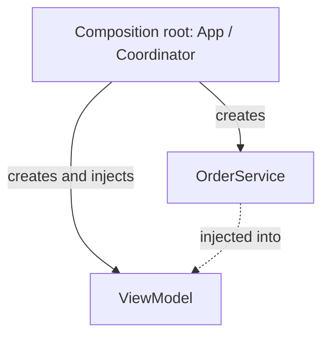

#Architecture #AppArchitecture

Objects get their dependencies from outside instead of creating them. Not an architecture itself, but every pattern needs it to be testable (replace real services with mocks).

Common approaches:
- **Initializer injection**: pass dependencies in `init`. Simple and explicit, the default
- **Container**: a central place that creates dependencies (e.g. Factory, Swinject)
- **SwiftUI `@Environment`**: dependencies passed down the view tree
- **TCA `@Dependency`**: see [[TCA]]

```swift
protocol OrderService { func orders() async throws -> [Order] }

final class OrdersViewModel {
    private let service: OrderService
    init(service: OrderService) { self.service = service }
}

// in tests
let viewModel = OrdersViewModel(service: MockOrderService())
```

**Pros**:
- testability: mocks instead of real network or database
- loose coupling via protocols
- dependencies are visible

**Cons**:
- initializers with many parameters
- containers can hide dependencies and fail at runtime instead of compile time


