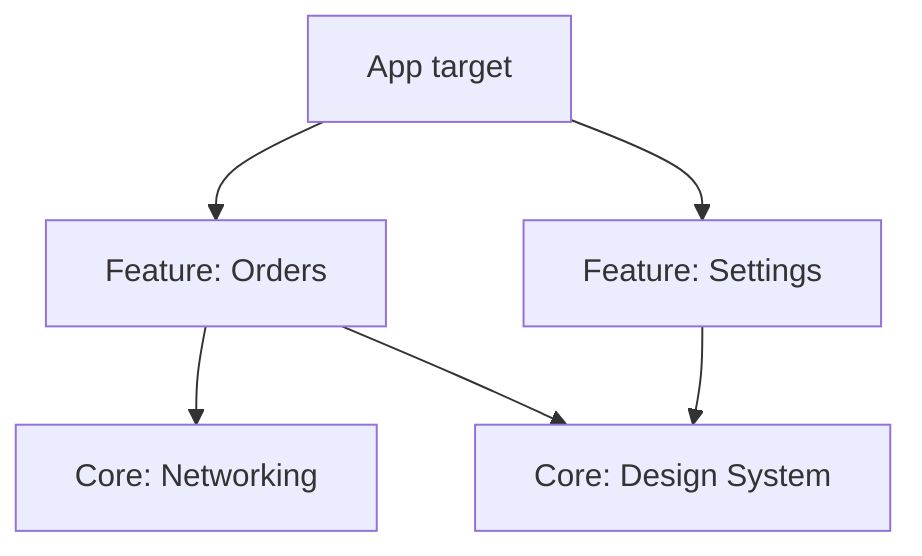

#Architecture #AppArchitecture

Splits the app into modules, usually Swift packages (SPM):
- **Feature modules**: one per feature (e.g. Login, Orders, Settings)
- **Core modules**: shared code (Networking, Persistence, Design System)
- **App target**: thin, only assembles the features
- feature modules don't depend on each other, only on core modules (or on interface modules)

**Pros**:
- faster builds, only changed modules recompile
- boundaries enforced by the compiler (`public` / `internal`)
- teams can work independently on their features
- features can be developed and tested in small demo apps

**Cons**:
- more setup and dependency management
- easy to cut modules wrong, e.g. too fine-grained or with circular dependencies
- navigation between features needs a shared concept (router, coordinator)

Relevant at team-lead / CTO level: module boundaries are also team boundaries. See [[iOS Architecture Overview]].
