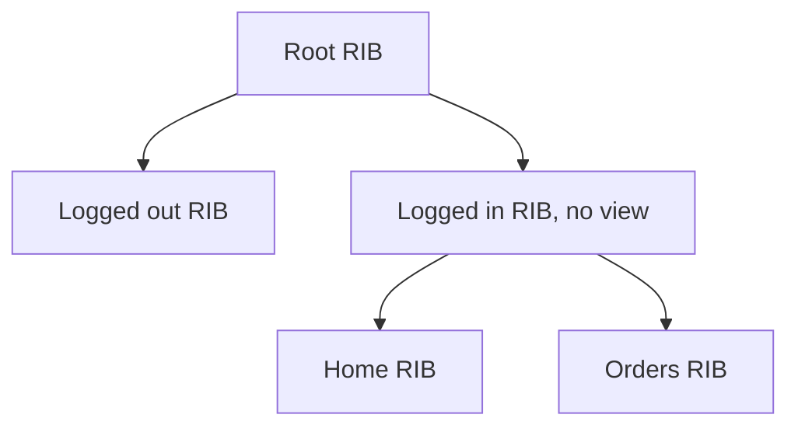

#Architecture #AppArchitecture #UIKit

**R**outer, **I**nteractor, **B**uilder, by Uber. The app's structure is driven by business logic, not by the view tree:
- **Builder**: creates the RIB and its dependencies
- **Interactor**: business logic, decides which child RIBs to attach
- **Router**: attaches and detaches child RIBs
- **View** (optional): a RIB can exist without UI, e.g. "logged in" state

**Pros**:
- built for very large apps with hundreds of developers
- business logic and app state independent of the UI

**Cons**:
- lots of boilerplate and tooling
- rarely used today, especially with SwiftUI

Mostly useful to know as an example of architecture for very large apps.

